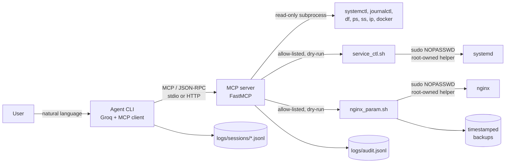

# Linux Agent — Agentic AI with MCP-Based Tool Use in Linux

Linux Agent is a complete, runnable final project for **LINUX OSS 2026**. It connects a
large language model to a Ubuntu host through the **Model Context Protocol (MCP)**, exposes
real diagnostic and configuration tools, and keeps every state-changing action
allow-listed, dry-run-first, human-approved and audited.

The project is intentionally more than an installation tutorial: it implements the MCP
server, the privileged helper scripts, the agent loop, the approval gate, the audit trail,
a test suite and an isolated lab demonstration.

---

## 1. What it does

| Capability | Examples |
|---|---|
| Inspect the host | identity, kernel, uptime, CPU, memory, disk, network, listening ports |
| Inspect systemd | status, journal logs, failed units, service list |
| Inspect nginx | version, `nginx -t`, managed parameters, backups, effective config |
| Inspect Docker | container list and logs |
| Controlled service actions | start / stop / restart / reload an allow-listed unit |
| Safe nginx changes | change 8 parameters, validate, back up, auto-rollback on failure, reload |
| Rollback | restore a timestamped configuration backup with a safety backup |
| Audit | JSONL tool audit on the server + session transcript on the agent |

**23 MCP tools**, **4 MCP resources/templates** and **3 MCP prompts** are exposed.

The agent is model-driven, but the security boundary is not: the MCP server re-validates
every argument, the privileged helper validates again, and the operating system enforces
the sudoers rule.

---

## 2. Architecture



The agent never receives a shell. It can only call typed tools. The server only executes
fixed argv arrays (no `shell=True`) and invokes two root-owned helpers through a narrow
sudoers rule.

### Request flow for a configuration change

```text
user: "change client_max_body_size to 20m"
  -> agent calls nginx_get_parameter / nginx_list_parameters   (read-only)
  -> agent calls nginx_set_parameter(..., dry_run=true)        (diff, no write)
  -> agent explains the diff and asks for approval
  -> approved: nginx_set_parameter(..., dry_run=false, reload=true)
       -> sudo -n /usr/local/libexec/linux-agent/nginx_param.sh set ...
            -> validate value
            -> copy current files to /var/backups/linux-agent/nginx/<id>
            -> write the managed drop-in or main directive atomically
            -> nginx -t
            -> on failure: restore backup and exit non-zero
            -> on success + --reload: systemctl reload nginx
  -> agent calls nginx_get_parameter to verify the new value
  -> every step is appended to the server audit log
```

---

## 3. Quick start (read-only, no root)

Requirements: Ubuntu 24.04/26.04 (tested on 26.04), Python 3.11+, systemd, nginx for the
nginx tools, optional Docker for the container tools.

```bash
cd /home/lcsang/linux-agent
python3 -m venv .venv
.venv/bin/pip install -r requirements.txt
cp .env.example .env
# edit .env and set GROQ_API_KEY

.venv/bin/python agent.py --list-tools
.venv/bin/python agent.py
```

Example prompts:

```text
Is nginx healthy? Show the last 20 journal lines.
Give me a host health summary and rank the findings by severity.
Which containers are running, and are any unhealthy?
Show me the managed nginx parameters and explain client_max_body_size.
Plan a change of client_max_body_size to 20m and show the dry-run diff.
```

By default `config/policy.toml` has `allow_write = false`, so even if the model asks for a
change, the server rejects it unless it is a dry run.

---

## 4. Enable controlled writes (one-time root install)

The helpers must be root-owned; otherwise a user could edit a script that sudo runs as
root. The installer copies them to `/usr/local/libexec/linux-agent`, writes
`/etc/linux-agent/allowed-units`, validates the sudoers rule with `visudo`, and installs
it atomically.

```bash
sudo scripts/install_privileged.sh --user "$USER" --units "nginx"

# Verify the non-interactive rule:
sudo -n /usr/local/libexec/linux-agent/nginx_param.sh list

# Enable writes for one agent session:
LINUX_AGENT_ALLOW_WRITE=1 .venv/bin/python agent.py
```

Then ask:

```text
Inspect nginx, then change client_max_body_size to 20m. Show the diff first.
After I approve, apply it and reload. Verify the value afterwards.
List the nginx backups and roll back the last change.
```

Add more units only when needed, for example `--units "nginx cron"` and the matching
`allowed = ["nginx", "cron"]` in `config/policy.toml`. Keep both layers in sync.

To remove everything (keeping logs/backups):

```bash
sudo scripts/uninstall_privileged.sh
sudo scripts/uninstall_privileged.sh --purge   # also delete logs and backups
```

---

## 5. Isolated lab demo (no root)

`scripts/lab_demo.sh` creates a temporary nginx-like configuration tree and a fake
`nginx`/`systemctl`, then runs the real server, helper and agent against it. It proves the
apply → verify → backup → rollback path without touching `/etc/nginx` or requiring sudo.
It still uses the real MCP server and the real `scripts/nginx_param.sh`.

```bash
bash scripts/lab_demo.sh
# artifacts stay in the printed LAB directory; the script cleans up unless KEEP=1
```

This is the recommended fallback for a presentation when the demo machine cannot grant
sudo.

---

## 6. Tool catalog

### Read-only

| Tool | Purpose |
|---|---|
| `system_overview` | Host, OS, kernel, uptime, load, CPU, memory, systemd state |
| `service_status` | `systemctl status` + recent lines |
| `service_logs` | `journalctl` with validated line count and time window |
| `list_services` | Services filtered by state |
| `failed_units` | Failed units with descriptions |
| `disk_usage` | `df -hT` |
| `process_top` | Top processes by CPU or memory |
| `network_overview` | Interfaces, routes, DNS |
| `listening_ports` | `ss -tulpn` (fallback `ss -tuln`) |
| `http_probe` | Local-only HTTP(S) probe, status/latency/headers/body preview |
| `package_info` | Installed version + APT policy |
| `read_config` | Read a file below allowed roots, redact secrets, line numbers |
| `container_list` | Docker containers |
| `container_logs` | Docker container logs |
| `nginx_info` | nginx version, unit state, config test |
| `nginx_list_parameters` | Current managed values |
| `nginx_get_parameter` | One managed value |
| `nginx_test_config` | Privileged `nginx -t` |
| `nginx_list_backups` | Timestamped backups |
| `nginx_diff_backup` | Unified diff for a backup |

### State-changing (dry-run by default, approval required to apply)

| Tool | Purpose |
|---|---|
| `service_action` | start / stop / restart / reload an allow-listed unit |
| `nginx_set_parameter` | validated parameter change + backup + test + optional reload |
| `nginx_rollback` | restore a backup with a safety backup and validation |

The MCP tool annotations mark read-only tools with `readOnlyHint=true` and write tools with
`readOnlyHint=false`. The agent uses these annotations plus a known-name list to decide
when to ask for approval.

### Resources and prompts

| Type | Name | Purpose |
|---|---|---|
| Resource | `linux://system/summary` | Live host summary |
| Resource | `linux://policy` | Active policy as JSON |
| Resource | `linux://nginx/parameters` | Current nginx values |
| Template | `linux://logs/{unit}` | Last 50 journal lines |
| Prompt | `triage_service` | Read-only incident triage plan |
| Prompt | `change_nginx_parameter` | Dry-run → approve → apply → verify workflow |
| Prompt | `host_health_report` | Evidence-based health report |

---

## 7. Security model

This project is a teaching example, but it treats the LLM as **untrusted input**:

1. **No shell.** Commands are fixed `argv` arrays; no `shell=True`, no `eval`, no string
   concatenation into a shell.
2. **Typed tools.** The model can only call the 23 registered tools.
3. **Two independent validators.** `linux_agent/security.py` validates unit names,
   actions, parameter names, values and paths; the shell helpers validate again.
4. **Allow-lists.** Service actions are limited to units in `policy.toml` **and**
   `/etc/linux-agent/allowed-units`. nginx parameters are limited to 8 known keys.
5. **Dry-run by default.** `service_action`, `nginx_set_parameter` and `nginx_rollback`
   default to `dry_run=true`.
6. **Human approval.** The CLI intercepts non-dry-run writes and asks `y/N/a`; scripted
   demos must pass `--auto-approve` explicitly.
7. **Root-owned helpers + narrow sudoers.** Only two absolute helper paths are allowed,
   with `NOPASSWD`, no wildcard shell. The caller cannot edit the root-owned copies.
8. **Backup + test + rollback.** `nginx -t` must pass before success; a failed test or
   reload restores the previous files and removes files that did not exist before.
9. **Path confinement and redaction.** `read_config` is limited to allowed roots; common
   secret assignments and private keys are redacted.
10. **Audit.** Every tool call is logged to `logs/audit.jsonl` with redacted arguments,
    result preview, status and duration. The agent keeps a separate session transcript.
11. **Rate limit.** Writes are serialized and separated by a minimum interval.
12. **Local-first transport.** HTTP mode binds `127.0.0.1` by default; there is no built-in
    authentication, so remote exposure must go through an authenticated reverse proxy.

### Threat model (summary)

| Threat | Control |
|---|---|
| Prompt injection asks for `rm -rf /` | No shell tool; fixed argv; allow-lists |
| Model invents a unit name | Regex + allow-list at server and helper |
| Model sets a dangerous nginx directive | Parameter allow-list; values validated; `nginx -t` |
| Malicious value breaks nginx | Timestamped backup, automatic restore |
| User tampers with helper | Root-owned 0755 helper, sudoers path restriction |
| Secrets leak into logs | Redaction + result preview truncation |
| Agent changes config without consent | Dry-run default + CLI approval gate |
| Another local process calls HTTP mode | Bind localhost by default; document proxy/auth |

Known limitations are discussed in `docs/report.md` (Chapter 7), including the absence of
built-in HTTP authentication, the trust placed in the LLM provider, and the fact that
`nginx -t` validates syntax rather than business intent.

---

## 8. Configuration

`config/policy.toml` controls everything:

| Section | Meaning |
|---|---|
| `[security]` | write gate, audit path, output limits, timeouts, minimum write interval |
| `[units]` | allowed units and actions |
| `[helpers]` | installed helper directory and helper names, `use_sudo` |
| `[nginx]` | unit, helper fallback, parameter specs (context, regex, description) |
| `[files]` | roots that `read_config` may read |
| `[network]` | hosts that `http_probe` may contact |
| `[agent]` | model, max steps, tool-output cap, temperature |

Environment overrides:

| Variable | Effect |
|---|---|
| `LINUX_AGENT_POLICY` | alternate policy file |
| `LINUX_AGENT_ALLOW_WRITE=1` | enable non-dry-run writes |
| `LINUX_AGENT_AUDIT_LOG` | alternate server audit path |
| `LINUX_AGENT_HELPER_DIR` | installed helper directory |
| `LINUX_AGENT_NGINX_HELPER` / `LINUX_AGENT_SERVICE_HELPER` | explicit helper file |
| `LINUX_AGENT_USE_SUDO=0` | call helpers directly (lab/testing only) |
| `LINUX_AGENT_MAX_STEPS` | agent step limit |
| `GROQ_MODEL` | override the Groq model id |

Keep `[units].allowed` and `/etc/linux-agent/allowed-units` consistent; they are two
independent layers.

---

## 9. MCP client configuration

Any MCP client can use the server over stdio:

```json
{
  "mcpServers": {
    "linux-agent": {
      "command": "/home/lcsang/linux-agent/.venv/bin/python",
      "args": ["/home/lcsang/linux-agent/server.py"],
      "env": {
        "LINUX_AGENT_ALLOW_WRITE": "0"
      }
    }
  }
}
```

For HTTP (Streamable HTTP):

```bash
.venv/bin/python server.py --transport streamable-http --host 127.0.0.1 --port 8000
.venv/bin/python agent.py --transport streamable-http --url http://127.0.0.1:8000/mcp
```

See `deploy/` for a systemd unit example and a documented sudoers example. Do not expose
the HTTP transport directly to a network without authentication.

---

## 10. Project structure

```text
linux-agent/
├── agent.py                     # CLI entry point (compatibility wrapper)
├── server.py                    # MCP server entry point (compatibility wrapper)
├── config/policy.toml           # allow-lists, limits, parameter specs
├── linux_agent/
│   ├── agent/                   # Groq client, MCP client, approval loop, CLI
│   ├── tools/                   # diagnostics, services, nginx
│   ├── audit.py                 # JSONL audit log
│   ├── config.py                # policy loader + env overrides
│   ├── runner.py                # no-shell subprocess runner
│   ├── runtime.py               # write gate, rate limit, audit decorator
│   ├── security.py              # validation, redaction, path confinement
│   └── server.py                # FastMCP registration + resources/prompts
├── scripts/
│   ├── nginx_param.sh           # safe nginx parameter changer
│   ├── service_ctl.sh           # allow-listed systemd helper
│   ├── install_privileged.sh    # root-owned install + sudoers validation
│   ├── uninstall_privileged.sh
│   └── lab_demo.sh              # no-root isolated demo
├── tests/                       # 29 unittest tests
├── deploy/                      # example systemd unit and sudoers file
├── docs/
│   ├── report.md                # final report (English)
│   ├── slides.md                # Marp slide deck (English)
│   ├── demo.md                  # presentation script
│   └── evidence/                # captured demo transcript
└── requirements.txt
```

---

## 11. Testing

```bash
make check        # compileall + bash -n
make test         # 29 tests
make tools        # list MCP tools without calling the LLM
```

The suite covers unit validation and injection rejection, secret redaction, path
confinement, policy loading, parameter bounds, the nginx helper (dry-run, apply, invalid
value, test failure restore, rollback), the service helper (allow-list, invalid unit,
invalid action), the agent approval policy, and an end-to-end MCP stdio test including
resources, prompts, write rejection and a lab write path.

Tested environment: Ubuntu 26.04.1 LTS, systemd 259, Python 3.14.4, `mcp` 1.30.0,
Groq `openai/gpt-oss-20b`, nginx 1.28.3.

---

## 12. Troubleshooting

| Symptom | Fix |
|---|---|
| `sudo: interactive authentication is required` | Run `scripts/install_privileged.sh` or keep write mode off; read-only tools still work |
| `Privileged helper not found` | Install helpers or set `LINUX_AGENT_NGINX_HELPER` / `LINUX_AGENT_SERVICE_HELPER` |
| `nginx -t` fails as a normal user | Expected: it needs root for the pid file; the helper runs it through sudo |
| `GROQ_API_KEY is not set` | Copy `.env.example` to `.env` and add the key |
| Model answers without calling tools | Ask it explicitly to inspect with tools; check `--max-steps` |
| `Unit ... is not allow-listed` | Add the unit to both policy and `/etc/linux-agent/allowed-units` |
| Writes still rejected | `LINUX_AGENT_ALLOW_WRITE=1` must be set in the **server** environment |
| HTTP client cannot connect | Check `--host/--port`, URL path `/mcp`, and local firewall |

---

## 13. Deliverables

- Final report in English: [`docs/report.md`](docs/report.md) (prebuilt `docs/report.pdf`)
- Slide deck in English (Marp): [`docs/slides.md`](docs/slides.md) (prebuilt
  `docs/slides.pdf`, `docs/slides.pptx` and `docs/slides.html`)
- Live demonstration script: [`docs/demo.md`](docs/demo.md)
- Captured lab evidence: [`docs/evidence/lab-demo.txt`](docs/evidence/lab-demo.txt)

Export slides to HTML/PDF with:

```bash
npx @marp-team/marp-cli docs/slides.md --html --allow-local-files --output docs/slides.html
npx @marp-team/marp-cli docs/slides.md --pdf  --allow-local-files --output docs/slides.pdf
npx @marp-team/marp-cli docs/slides.md --pptx --allow-local-files --output docs/slides.pptx
```

The code is the primary artifact; the report explains the design and evaluation, and the
slides support the oral defence.

---

## 14. License

MIT. See `LICENSE`.
