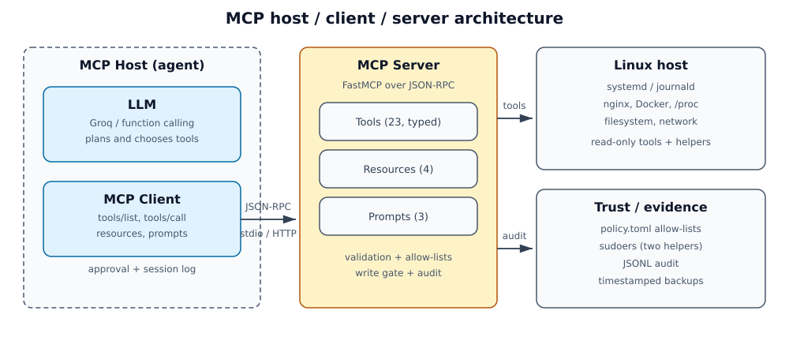
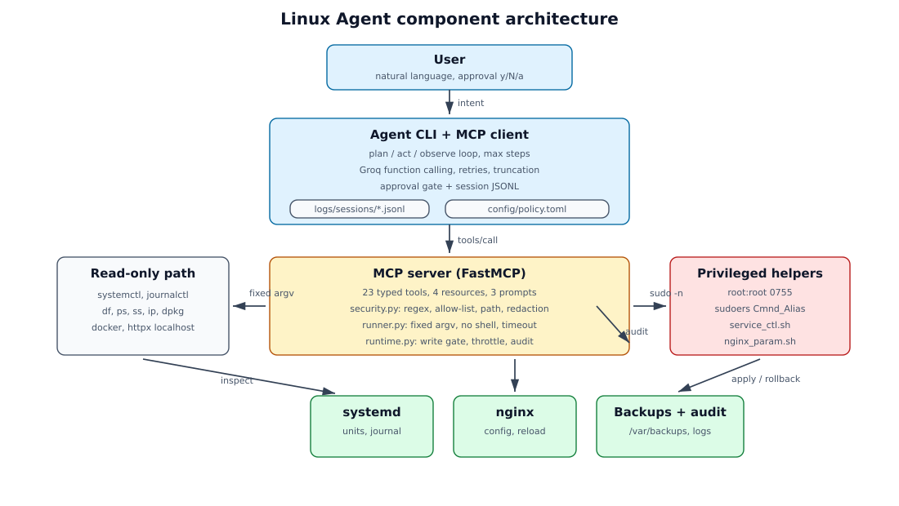
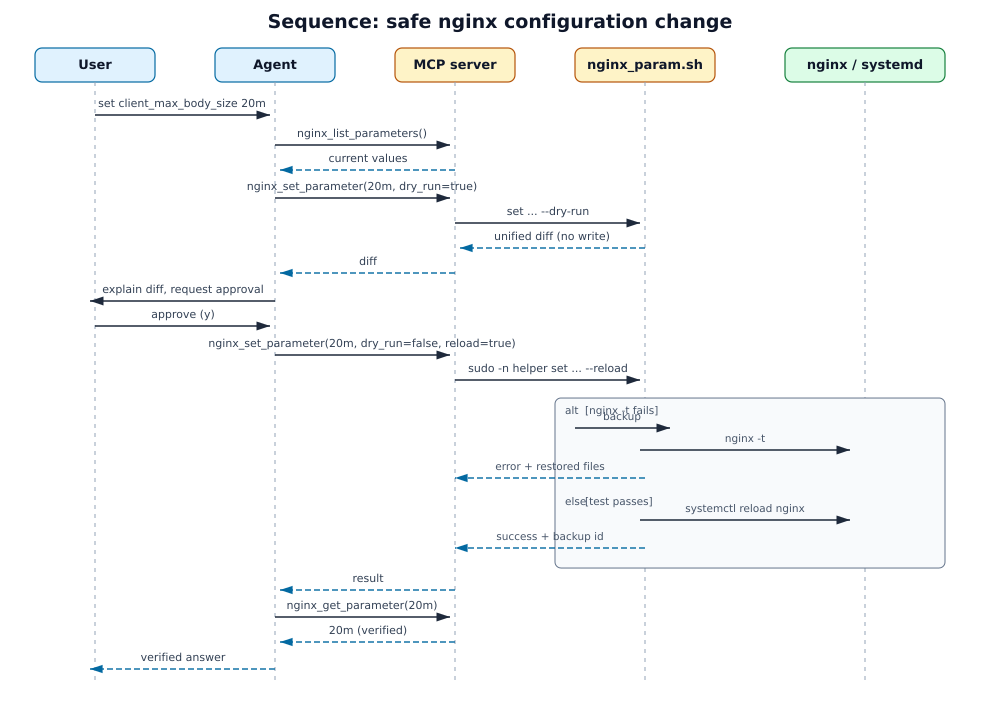
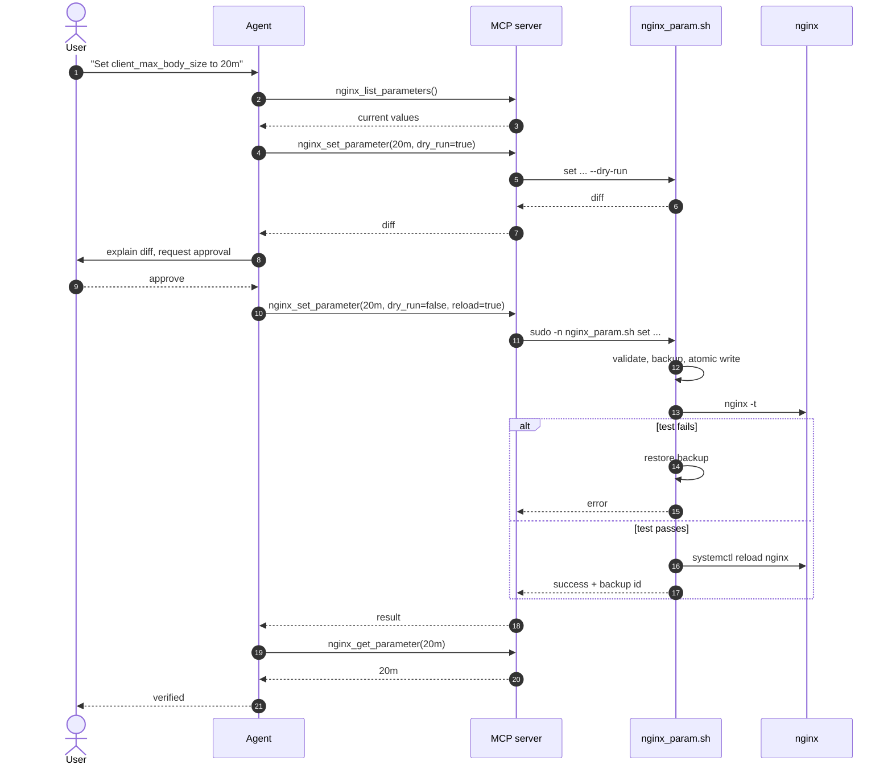
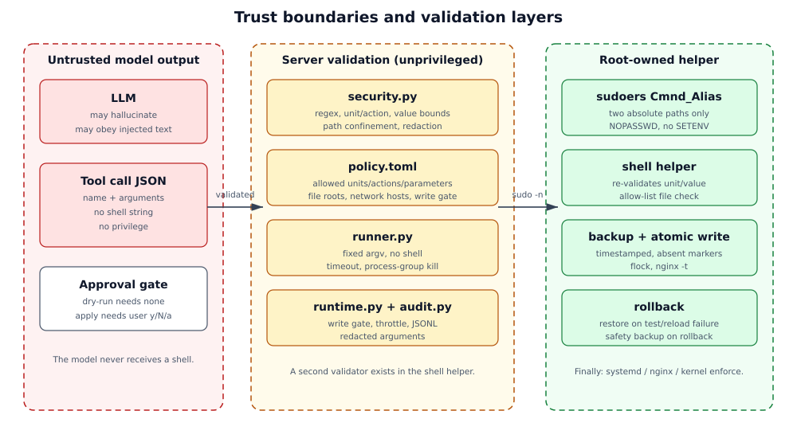
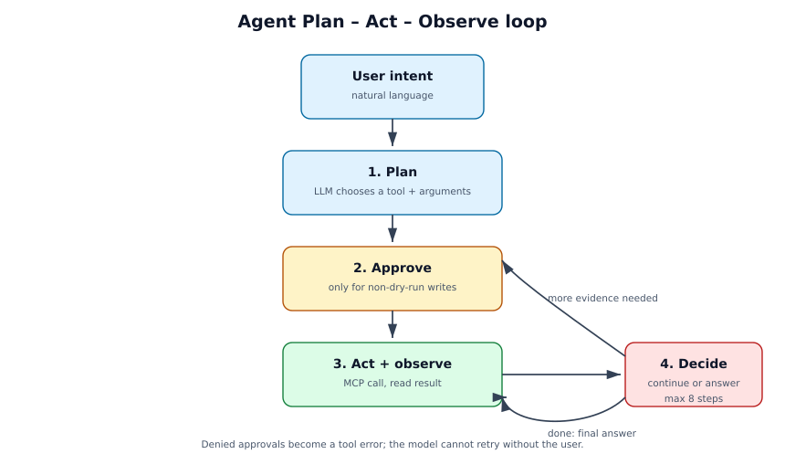
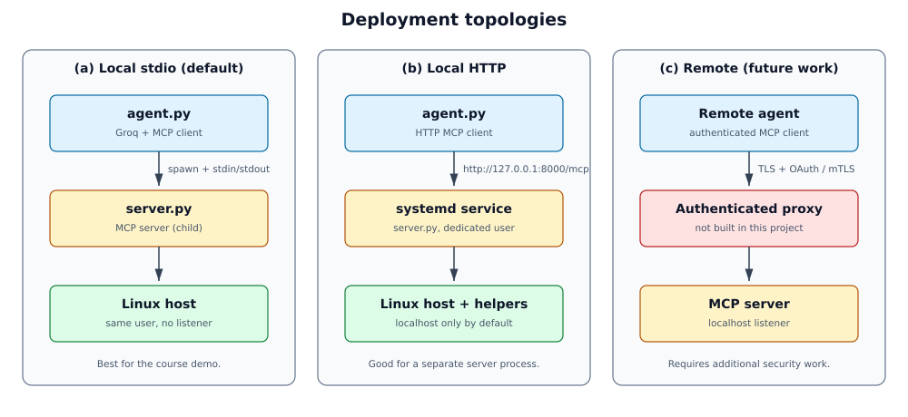

<div align="center">

# UNIVERSITY OF INFORMATION TECHNOLOGY
### VIETNAM NATIONAL UNIVERSITY HO CHI MINH CITY
#### Faculty of Computer Networks and Communications

<br><br>

# FINAL PROJECT REPORT

## Develop an Agentic AI System with MCP-Based Tool Use in Linux

<br>

**Course:** Linux and Open-Source Software (LINUX OSS 2026)

**Project direction:** Agentic AI, MCP, Tool Use and Linux Automation

<br><br>

| Group member | Student ID | Contribution |
|---|---|---|
| [Full name] | [Student ID] | MCP server, tools, security |
| [Full name] | [Student ID] | Agent, demo, evaluation |
| [Full name] | [Student ID] | Report, slides, testing |

**Lecturer:** [Lecturer name]

**Date:** November 2026

</div>

<div style="page-break-after: always;"></div>

## Declaration of Authorship

We declare that this report and the accompanying source code are our own work. External
ideas, specifications and software are acknowledged in the references. The project was
tested on a real Ubuntu 26.04 host and in an isolated laboratory configuration. We did not
use another group's code, and we did not hide failed experiments: the limitations section
records what the system does not solve.

Signed: ____________________  Date: ____________

<div style="page-break-after: always;"></div>

## Abstract

Linux administration is repetitive, stateful and risky: an operator has to inspect
services, read logs, understand configuration contexts, change one value, validate the
result and be ready to roll back. Large language models (LLMs) can explain such work, but
a chat window cannot safely operate a machine. This project builds **Linux Agent**, an
agentic system that connects a Groq-hosted LLM to an Ubuntu host through the **Model
Context Protocol (MCP)**. The system implements an MCP server with 23 typed tools, four
resources/resource templates and three prompts; a small Plan–Act–Observe agent loop; a
human approval gate; a JSONL audit trail; and two root-owned helper scripts that perform
allow-listed systemd actions and safe nginx configuration changes.

The central design claim is that the language model should be treated as untrusted input.
The model never receives a shell. The server validates every argument, the shell helpers
validate again, and the operating system enforces a narrow sudoers rule. Configuration
changes are dry-run by default, create a timestamped backup, run `nginx -t`, and restore
the previous files automatically if validation or reload fails. The agent asks for
explicit approval before any non-dry-run change and records every step.

The implementation is evaluated with 29 automated tests, an end-to-end MCP stdio test, an
isolated write/rollback laboratory, and a real-host demonstration. All tests pass. On the
test host, read-only tool calls take roughly 6–65 ms and a complete LLM turn takes about
2.6 s including server startup. The laboratory applies a `client_max_body_size` change,
verifies it, creates a backup, and rolls it back without root. The report also analyses
residual risks: prompt injection, approval fatigue, HTTP authentication, audit integrity
and the limits of syntax-only validation. The result is a reproducible teaching platform
for agentic Linux automation, not a production control plane.

**Keywords:** agentic AI, Model Context Protocol, MCP, Linux, systemd, nginx, tool use,
human-in-the-loop, least privilege, audit.

<div style="page-break-after: always;"></div>

## Table of Contents

1. [Introduction](#1-introduction)
2. [Background and Related Work](#2-background-and-related-work)
3. [Requirements and Analysis](#3-requirements-and-analysis)
4. [System Design](#4-system-design)
5. [Implementation](#5-implementation)
6. [Testing and Evaluation](#6-testing-and-evaluation)
7. [Discussion, Limitations and Future Work](#7-discussion-limitations-and-future-work)
8. [Conclusion](#8-conclusion)
9. [References](#9-references)
10. [Appendices](#10-appendices)

## List of Figures

- Figure 1. MCP host/client/server architecture.
- Figure 2. Linux Agent component architecture.
- Figure 3. Sequence diagram for a safe nginx configuration change.
- Figure 4. Trust boundaries and validation layers.
- Figure 5. Agent Plan–Act–Observe loop.
- Figure 6. Deployment topologies.

## List of Tables

- Table 1. Functional requirements.
- Table 2. Non-functional requirements.
- Table 3. Risk analysis.
- Table 4. Requirement traceability.
- Table 5. MCP tool catalog.
- Table 6. Policy sections.
- Table 7. Test matrix and results.
- Table 8. Performance measurements.
- Table 9. Residual risks and mitigations.

## List of Abbreviations

| Abbreviation | Meaning |
|---|---|
| AI | Artificial Intelligence |
| API | Application Programming Interface |
| CLI | Command-Line Interface |
| HTTP | Hypertext Transfer Protocol |
| JSON-RPC | JSON Remote Procedure Call |
| LLM | Large Language Model |
| MCP | Model Context Protocol |
| NFR | Non-functional Requirement |
| OWASP | Open Worldwide Application Security Project |
| RBAC | Role-Based Access Control |
| stdio | Standard input/output |
| TOML | Tom's Obvious Minimal Language |

<div style="page-break-after: always;"></div>

# 1. Introduction

## 1.1 Context and motivation

A Linux server exposes a large, stateful surface: systemd units, journal logs, nginx
configuration files, HTTP endpoints, packages, containers and network sockets. A routine
task such as "increase the maximum upload size" is not a single command. The operator must
find the effective configuration, understand whether the directive belongs to the `main`,
`events`, `http`, `server` or `location` context, change it without breaking the file,
validate it with `nginx -t`, reload the service, verify the result, and keep a rollback
path. Copying commands from a tutorial ignores most of these steps.

Agentic AI offers a different interface. Instead of asking an operator to translate intent
into commands, an LLM can plan a sequence of tool calls, observe the results and revise the
plan. The missing piece is a controlled tool boundary. Giving an LLM an unrestricted shell
is both unsafe and unreproducible. The **Model Context Protocol (MCP)** standardises that
boundary: a host (the agent) connects to a server, discovers typed tools, calls them with
JSON arguments and receives structured results.

This project asks a practical question:

> Can a small, open, auditable MCP server let an LLM perform useful Linux administration
> while keeping the human in control and the blast radius small?

The answer is a working system, not a slideware architecture. Linux Agent runs on a real
Ubuntu host, reads real systemd and nginx state, and can change an allow-listed nginx
parameter through a root-owned helper after explicit approval.

## 1.2 Problem statement

The project addresses four problems:

1. **Tool integration.** An LLM needs typed, discoverable tools with clear descriptions
   and machine-readable schemas. Ad-hoc shell snippets are not discoverable, not typed and
   not auditable.
2. **Safety.** The model can hallucinate a unit name, a path, a parameter or a value. A
   production-quality design must assume the model is wrong and validate everything at a
   trust boundary.
3. **Change safety.** A configuration change must be reversible. The system needs
   validation, backups, automatic rollback and a human approval step.
4. **Observability.** The operator must be able to reconstruct what the agent did, with
   which arguments, when, and with what result.

## 1.3 Objectives

The concrete objectives are:

- Research agentic AI architecture, tool use and the Model Context Protocol.
- Deploy an MCP server on Linux and expose at least ten useful tools, including
  read-only diagnostics and controlled state changes.
- Implement the "extra shell script" required by the course: a safe nginx parameter
  changer that validates, backs up, tests and rolls back configuration changes.
- Integrate the tools with an LLM agent that plans, calls tools, observes results and
  reports honestly.
- Enforce least privilege with allow-lists, dry-run defaults, human approval, a narrow
  sudoers rule and an audit log.
- Demonstrate real interaction between the agent and Linux services on a real host and in
  an isolated reproducible laboratory.
- Produce an English final report and slide deck in the style of a "Đồ Án Cơ Sở" report.

## 1.4 Scope

**In scope**

- Ubuntu 24.04/26.04 with systemd.
- nginx as the primary configurable service; systemd units as the action target.
- Read-only inspection of processes, disks, network, packages and Docker containers.
- MCP over stdio (default) and Streamable HTTP (localhost).
- Groq as the LLM provider, using OpenAI-compatible function calling.
- Eight allow-listed nginx parameters: `worker_processes`, `worker_connections`,
  `client_max_body_size`, `keepalive_timeout`, `client_body_timeout`, `send_timeout`,
  `gzip` and `server_tokens`.

**Out of scope**

- A production multi-tenant control plane.
- Arbitrary shell execution, arbitrary file editing or arbitrary package installation.
- Built-in HTTP authentication or authorisation.
- Services other than nginx for configuration changes (the service helper is generic, but
  the policy is intentionally narrow).
- Automatic remediation without human approval.

## 1.5 Deliverables

| Deliverable | Location |
|---|---|
| MCP server and tools | `linux_agent/`, `server.py` |
| Agent CLI | `linux_agent/agent/`, `agent.py` |
| Privileged helpers | `scripts/nginx_param.sh`, `scripts/service_ctl.sh` |
| Installer and sudoers validation | `scripts/install_privileged.sh` |
| Policy | `config/policy.toml` |
| Tests | `tests/` (29 tests) |
| Final report | `docs/report.md` |
| Slides | `docs/slides.md` |
| Demo script and evidence | `docs/demo.md`, `docs/evidence/` |

## 1.6 Report structure

Chapter 2 explains the background: systemd, nginx contexts, agentic AI and MCP. Chapter 3
derives requirements and risks. Chapter 4 presents the architecture and security model.
Chapter 5 describes the implementation. Chapter 6 reports the test plan, results and
performance. Chapter 7 discusses limitations and future work. Chapter 8 concludes.

<div style="page-break-after: always;"></div>

# 2. Background and Related Work

## 2.1 Linux service management

**systemd** is the service manager on modern Ubuntu. A unit is described by a file such as
`/lib/systemd/system/nginx.service`; `systemctl status` shows state and recent log lines,
`systemctl start|stop|restart|reload` changes state, and `journalctl -u` reads the journal.
`systemctl is-active` gives a machine-friendly state.

Two properties matter for automation. First, unit names are not arbitrary strings: they
have a grammar and must never be confused with command-line options. A leading `-` or a
value containing `;` can change the meaning of a command. Second, actions are not equal:
`reload` is usually graceful, `restart` interrupts connections, and `stop` takes the
service down. The agent must know which action the user asked for and must not silently
substitute a more destructive one.

**nginx** is a web server and reverse proxy. Its configuration is a tree of contexts. A
directive is legal only in specific contexts. For example, `worker_processes` is a `main`
context directive, `worker_connections` belongs in `events`, and `client_max_body_size`,
`keepalive_timeout`, `gzip` and `server_tokens` are valid in `http` (and some also in
`server`/`location`). Ubuntu's default `nginx.conf` includes
`/etc/nginx/conf.d/*.conf` inside the `http` block, so a managed drop-in is the cleanest
way to change HTTP-level parameters.

`nginx -t` parses the configuration and reports syntax errors, but it does not prove that a
change is semantically desirable. A value can be syntactically valid and still be a bad
operational choice. This is why the design keeps a human approval step even after
validation.

## 2.2 Agentic AI and tool use

An LLM alone maps text to text. An **agent** adds a loop:

1. **Plan:** interpret the goal and choose a next action.
2. **Act:** call a tool with structured arguments.
3. **Observe:** read the tool result.
4. **Revise:** continue, stop or ask for clarification.

This is often called a ReAct-style loop. Modern LLM APIs expose **function calling**:
the caller supplies JSON schemas for tools, the model returns a tool name and JSON
arguments, and the caller executes the tool and appends the result to the conversation.
The model does not execute anything itself. This separation is the foundation of the
security model in this project.

Agentic systems are useful when the environment changes between steps, when the task
requires multiple sources of truth, and when the correct next step depends on the result of
the previous one. Linux administration fits all three: service state, logs, configuration
and network probes interact.

## 2.3 The Model Context Protocol

MCP is an open protocol that standardises how an AI application (the **host**) discovers
and calls capabilities exposed by a **server**. The host contains one or more **clients**;
each client maintains a session with a server. The protocol uses JSON-RPC 2.0 messages.

MCP defines three server primitives:

- **Tools** are callable functions with a name, description and JSON Schema. They may have
  side effects; tool annotations such as `readOnlyHint` and `destructiveHint` help the
  client reason about risk.
- **Resources** are readable data identified by a URI, such as a file, a status document
  or a log. Resources are application-controlled, not model-controlled.
- **Prompts** are reusable templates that a user or host can invoke to structure a task.

The two common transports are **stdio** (the client spawns the server process and speaks
over stdin/stdout) and **Streamable HTTP** (the server exposes an HTTP endpoint, optionally
with server-sent events). stdio is ideal for a local desktop agent; HTTP is useful when the
server runs as a service.

The official Python SDK provides `FastMCP`, which turns decorated Python functions into
MCP tools, resources and prompts. It generates JSON Schema from type hints and docstrings,
which keeps the tool contract close to the implementation.



*Figure 1. A host (the agent) contains an MCP client; the client talks JSON-RPC to an MCP
server; the server owns the actual tools and data. Figure source: `docs/diagrams/`.*

## 2.4 Why MCP instead of ad-hoc shell scripts

A shell script can automate one task, but it is not discoverable by a model, has no schema,
and usually has no policy boundary. MCP adds:

- **Discoverability:** the client calls `tools/list` and receives names, descriptions and
  JSON Schemas.
- **Typed arguments:** the model must produce a JSON object; validation happens before
  execution.
- **Composability:** the same server can be used by different hosts and languages.
- **Observability:** tool calls are discrete events that can be logged and approved.
- **Separation of concerns:** the model reasons; the server enforces.

The trade-off is more moving parts and a new protocol surface. For a teaching project, that
surface is valuable because it makes the security boundary explicit.

## 2.5 Related work

- **MCP reference servers** (filesystem, git, fetch, memory) demonstrate the protocol but
  are not designed for privileged Linux administration.
- **LangChain / LlamaIndex tool agents** provide orchestration but usually leave the
  execution boundary to the application.
- **OpenAI function calling and Groq's OpenAI-compatible API** provide the model side of
  tool use; this project uses Groq's API with an OpenAI-compatible schema.
- **Ansible** is the mature declarative configuration-management approach. It is
  idempotent and auditable, but it is not conversational and does not decide what to do
  from natural-language intent.
- **CMU's Agents course** and the public "Linux agent" example motivate the combination of
  a reasoning loop with Linux tools.

Linux Agent deliberately does not replace Ansible. It explores the layer above: how a
model can choose and parameterise safe operations, with a human approving the risky ones.

## 2.6 Security principles used in this project

1. **Least privilege.** The agent runs as the normal user. Only two root-owned helpers are
   reachable through sudo, and only for allow-listed operations.
2. **Defence in depth.** Validation happens in the Python server, again in the shell
   helper, and finally in the kernel/sudo policy.
3. **Human in the loop.** A state-changing tool is not executed until the user approves it.
4. **Fail safe.** Dry-run is the default. If validation fails, the previous configuration
   is restored.
5. **Complete mediation.** Every tool call goes through the same audited registration
   wrapper.
6. **Economy of mechanism.** The helpers are small, readable shell scripts with explicit
   cases, not a general command interpreter.
7. **Auditability.** Arguments, results, status and duration are recorded in JSONL.
8. **Assume prompt injection.** Any text the model reads (logs, configuration, web pages)
   may contain instructions. The server never trusts model output as a command.

<div style="page-break-after: always;"></div>

# 3. Requirements and Analysis

## 3.1 Stakeholders and use cases

| Actor | Goal |
|---|---|
| Student operator | Inspect and demonstrate Linux services from natural language |
| Teaching assistant / lecturer | Verify that the implementation is real, reproducible and safe |
| System administrator | Delegate a narrow, auditable operation without giving a shell |
| Security reviewer | Trace every privileged path and test the boundaries |

Primary use cases:

- **UC1 – Host health check:** ask for a summary; agent calls read-only tools.
- **UC2 – Service triage:** ask why nginx is unhealthy; agent reads status and logs.
- **UC3 – Safe configuration change:** ask to change a parameter; agent inspects, dry-runs,
  asks for approval, applies, validates and verifies.
- **UC4 – Rollback:** ask to undo the last change; agent lists backups and restores one.
- **UC5 – Service action:** ask to restart/reload an allow-listed unit; agent previews and
  applies after approval.
- **UC6 – Audit review:** operator inspects the JSONL trail and session transcript.

## 3.2 Functional requirements

| ID | Requirement | Priority |
|---|---|---|
| FR1 | Expose host identity, uptime, CPU, memory, disk and systemd state | Must |
| FR2 | Expose systemd status, journal logs, failed units and service lists | Must |
| FR3 | Expose network interfaces, routes, DNS and listening ports | Must |
| FR4 | Expose nginx version, config test and managed parameter values | Must |
| FR5 | Allow only allow-listed units and actions | Must |
| FR6 | Change only allow-listed nginx parameters with validated values | Must |
| FR7 | Back up configuration before a change and restore on failure | Must |
| FR8 | Dry-run configuration and service changes | Must |
| FR9 | Require human approval for non-dry-run writes | Must |
| FR10 | Record every tool call in an audit log | Must |
| FR11 | Provide MCP resources and prompts in addition to tools | Should |
| FR12 | Support stdio and Streamable HTTP transports | Should |
| FR13 | Expose Docker container list and logs | Could |
| FR14 | Provide a reproducible lab demo without root | Should |
| FR15 | Provide an installer that validates sudoers with `visudo` | Must |

## 3.3 Non-functional requirements

| ID | Requirement | Acceptance criterion |
|---|---|---|
| NFR1 | Safety | No shell execution; all arguments validated at two layers |
| NFR2 | Security | A non-allow-listed unit or parameter is rejected before execution |
| NFR3 | Reversibility | A failed `nginx -t` restores the previous files automatically |
| NFR4 | Performance | Read-only tool calls under 500 ms on the test host |
| NFR5 | Usability | A new user can run the read-only demo in under five minutes |
| NFR6 | Portability | Runs on Ubuntu 24.04/26.04 with Python 3.11+ |
| NFR7 | Maintainability | Tools are separated by domain; policy is data, not code |
| NFR8 | Observability | Audit entries include timestamp, tool, args, result, duration, status |
| NFR9 | Reproducibility | Tests run without root and without changing the host |
| NFR10 | Documentation | README, report, slides and demo script are in English |

## 3.4 Risk analysis

| Risk | Likelihood | Impact | Mitigation |
|---|---|---|---|
| Prompt injection asks for destructive command | Medium | High | No shell tool; fixed argv; allow-lists; approval |
| Model hallucinates a unit/parameter | High | Medium | Regex + allow-list at server and helper |
| Bad value breaks nginx | Medium | High | Value bounds; `nginx -t`; backup; automatic rollback |
| User edits a helper that sudo runs | Low | Critical | Root-owned 0755 helper; sudoers path restriction |
| Secret leaks into audit/LLM context | Medium | High | Redaction patterns; result truncation; local-only files |
| Agent changes config without consent | Medium | High | Dry-run default; CLI approval; write gate |
| HTTP endpoint exposed to network | Low | High | Bind localhost by default; document proxy/auth |
| Audit log tampering | Low | Medium | Append-only JSONL; can be shipped to remote syslog |
| Approval fatigue | Medium | Medium | Dry-run diffs; "always" only for one tool/session |
| Model provider outage | Medium | Low | Retries; clear error; read-only tools still work directly |

## 3.5 Requirement traceability

| Requirement | Design/implementation | Test evidence |
|---|---|---|
| FR1–FR3 | `tools/diagnostics.py` | `test_mcp_server`, manual demo |
| FR4 | `tools/nginx.py`, `nginx_param.sh list/get` | `test_nginx_script`, MCP test |
| FR5 | `policy.toml`, `services.py`, `service_ctl.sh` | `test_nginx_script` service tests |
| FR6 | `config.py` parameter specs, `nginx_param.sh` | `test_security`, `test_nginx_script` |
| FR7 | `create_backup`, `restore_backup` | `test_failed_config_test_*`, rollback test |
| FR8 | `dry_run=True` defaults | MCP test, lab demo |
| FR9 | `MCPAgent.needs_approval`, CLI prompt | `test_agent_policy` |
| FR10 | `Runtime.audited`, `AuditLog` | MCP test audit assertions |
| FR11 | `server.py` resources/prompts | MCP test |
| FR12 | `server.py`, `client.py` | Manual HTTP run |
| FR13 | `container_list`, `container_logs` | Manual demo |
| FR14 | `scripts/lab_demo.sh` | Lab transcript |
| FR15 | `install_privileged.sh` | `visudo -cf` in installer |

<div style="page-break-after: always;"></div>

# 4. System Design

## 4.1 Architecture



*Figure 2. The agent, MCP server, privileged helpers, policy and audit store. The model is
outside the trust boundary; the server and helpers validate its output.*

The system has five layers:

1. **User interface:** interactive CLI or one-shot prompts.
2. **Agent:** Groq LLM, MCP client, approval gate, session log.
3. **MCP server:** FastMCP registration, tool implementations, resources, prompts,
   policy enforcement, audit.
4. **Privileged helpers:** `service_ctl.sh` and `nginx_param.sh`, invoked through a narrow
   sudoers rule.
5. **Linux services:** systemd, journald, nginx, Docker and the filesystem.

## 4.2 Components

### 4.2.1 Agent CLI

`linux_agent/agent/cli.py` parses arguments, loads the policy, opens either a stdio or
Streamable HTTP MCP session, lists tools, and runs the loop. The system prompt includes the
host name, whether writes are enabled, the allow-listed units and the managed parameters.
The prompt tells the model to inspect first, dry-run changes and never invent output.

The agent supports:

- interactive mode with `/tools`, `/reset`, `/audit`, `/policy`, `/quit`;
- one-shot prompts with `--prompt` (repeatable);
- `--list-tools` without an API key;
- `--auto-approve` for supervised demos;
- `--quiet` to hide tool output previews.

### 4.2.2 MCP client and LLM provider

`linux_agent/agent/client.py` contains `GroqLLM` and `MCPAgent`. `GroqLLM` wraps
`client.chat.completions.create` with the MCP tools converted to OpenAI function schemas.
It retries rate limits, connection errors and timeouts with exponential backoff and runs
the blocking SDK call in a worker thread so the event loop stays responsive.

`MCPAgent` maintains the message history, calls the model, executes tool calls, appends
tool results, enforces the step limit and asks the approval callback when needed. Tool
results are truncated for the model to protect the context window; the full result remains
in the audit log.

### 4.2.3 MCP server and tool modules

`linux_agent/server.py` builds a `FastMCP` instance and registers three modules:

- `tools/diagnostics.py` — read-only host, systemd, network, package, config, Docker and
  nginx inspection.
- `tools/services.py` — `service_action`.
- `tools/nginx.py` — parameter inspection and controlled changes.

Every tool is wrapped by `Runtime.audited`, which records the call. Tools return plain text
that is easy for an LLM to read and easy for a human to verify. Structured JSON is used for
the policy resource.

### 4.2.4 Policy and configuration

`config/policy.toml` is data, not code. It contains the write gate, audit path, output
limits, timeouts, allowed units/actions, helper paths, nginx parameter specifications, file
roots, network allow-list and agent settings. `linux_agent/config.py` loads it with
`tomllib`, applies environment overrides and exposes typed accessors.

Keeping policy in data makes the security review simple: a reviewer can read one file and
know exactly which units and parameters are reachable.

### 4.2.5 Privileged helpers

The two helpers are the only privileged code:

- `scripts/service_ctl.sh` validates an action and unit, checks
  `/etc/linux-agent/allowed-units`, calls `systemctl`, records the result and prints the
  new state.
- `scripts/nginx_param.sh` implements the course's "extra shell script" requirement:
  validation, context-aware editing, backup, atomic write, `nginx -t`, reload, rollback and
  a lock.

`scripts/install_privileged.sh` copies them to `/usr/local/libexec/linux-agent`, sets
`root:root 0755`, writes the allow-list, generates a sudoers rule with a `Cmnd_Alias`,
validates it with `visudo -cf`, and installs it as `0440`. The repository copies are not
trusted at runtime.

### 4.2.6 Audit

`linux_agent/audit.py` writes one JSON object per line. Each entry has a UTC timestamp,
event type, process ID, user, tool name, redacted arguments, status, duration and a result
preview. The agent writes a separate session transcript containing user messages,
assistant messages, tool calls, approvals and results. This separation is useful: the server
audit is the authoritative record of tool execution, while the session log is the
conversation context.

## 4.3 Sequence: safe nginx change



*Figure 3. The agent inspects, dry-runs, asks for approval, applies through the helper,
validates, reloads and verifies.*



## 4.4 Trust boundaries



*Figure 4. Model output crosses into the server as untrusted JSON; the server crosses into
the helper as validated arguments; the helper crosses into the kernel through sudo.*

| Boundary | Input | Control |
|---|---|---|
| User → agent | Natural language | The user is the principal; the agent explains actions |
| Model → server | Tool name + JSON args | Schema, regex, allow-lists, value bounds |
| Server → helper | argv | Fixed binary, validated strings, no shell |
| Helper → kernel | `systemctl`, `nginx` | sudoers command restriction, root-owned helper |
| Helper → filesystem | config paths | Fixed destinations, atomic writes, backups |
| Server/agent → log | Tool results | Redaction, preview truncation, local file permissions |

## 4.5 Tool design

The tool catalog follows three rules:

1. **One job per tool.** `disk_usage` does not also read nginx configuration.
2. **Read-only unless the name says otherwise.** Read-only tools are annotated and never
   require approval.
3. **Dry-run first for writes.** A write tool has a `dry_run` parameter that defaults to
   true and is documented in the description.

| Tool | Type | Arguments | Side effect |
|---|---|---|---|
| `system_overview` | read | – | none |
| `service_status` | read | unit | none |
| `service_logs` | read | unit, lines, since | none |
| `list_services` | read | state, limit | none |
| `failed_units` | read | – | none |
| `disk_usage` | read | – | none |
| `process_top` | read | sort_by, limit | none |
| `network_overview` | read | – | none |
| `listening_ports` | read | – | none |
| `http_probe` | read | url | outbound HTTP to allow-listed host |
| `package_info` | read | name | none |
| `read_config` | read | path, max_lines | none |
| `container_list` | read | all_containers | none |
| `container_logs` | read | name, lines | none |
| `nginx_info` | read | – | none |
| `nginx_list_parameters` | read | – | none |
| `nginx_get_parameter` | read | parameter | none |
| `nginx_test_config` | read | – | none |
| `nginx_list_backups` | read | – | none |
| `nginx_diff_backup` | read | backup_id | none |
| `service_action` | write | unit, action, dry_run | systemd state |
| `nginx_set_parameter` | write | parameter, value, reload, dry_run | nginx config |
| `nginx_rollback` | write | backup_id, reload, dry_run | nginx config |

## 4.6 Security architecture

The design uses seven layers:

1. **No shell.** `runner.py` uses `subprocess.Popen` with an argv list, `shell=False` by
   default, a minimal environment, a timeout and process-group kill. There is no tool that
   accepts a command string.
2. **Syntactic validation.** `security.py` validates unit names, action names, parameter
   names, package names, container names, backup IDs, paths and time windows.
3. **Policy validation.** The server checks the unit/action against `policy.toml`; the
   nginx parameter must exist in the policy and the value must match the parameter regex
   and semantic bounds.
4. **Privilege separation.** The server runs as a normal user. Only the two helpers are
   allowed through sudo, with no wildcard command and no shell.
5. **Change safety.** The helper creates a timestamped backup, writes atomically, runs
   `nginx -t`, restores on failure, and optionally reloads. A file lock prevents concurrent
   changes.
6. **Human approval.** The agent asks before a non-dry-run write. `--auto-approve` is an
   explicit opt-in for supervised demos.
7. **Audit and redaction.** Every tool call is logged with redacted arguments. Common
   secret assignments and private keys are removed from config reads and HTTP bodies.

### Why two validation layers?

The Python layer is convenient and produces good error messages for the model. The shell
layer is the last line of defence if the server is compromised, misconfigured or called by
a different MCP client. Duplicating a small amount of validation is cheaper than trusting a
single process.

### Why dry-run by default?

An LLM can misunderstand intent. A dry run produces a diff and a clear "no change was
made" message. It also gives the human a concrete artifact to approve. The lab and tests
show that a dry run does not create the managed file.

## 4.7 nginx helper algorithm

```text
set(parameter, value, dry_run, reload):
    validate parameter is in the allow-list
    validate value against the parameter regex and bounds
    read the current value
    render a candidate file:
        http parameters -> managed drop-in 99-linux-agent.conf
        main/events     -> replace the existing directive in nginx.conf
    if candidate == current: report "no change" and stop
    if dry_run: show unified diff and stop
    acquire the file lock
    create a timestamped backup (including absent-file markers)
    atomically replace the target
    run nginx -t
    if the test fails:
        restore the backup
        report failure
    if reload requested:
        systemctl reload nginx
        if reload fails:
            restore the backup, restore the old running config, report failure
    print success, backup id, test output and diff
```

Two details are important:

- **Absent-file markers.** If the managed drop-in did not exist before the change, the
  backup records that fact. A failed test removes the new file instead of leaving a
  half-applied change.
- **Safety backup on rollback.** Rolling back is itself a change. The helper first backs up
  the current state, so a failed rollback can be undone.

## 4.8 Agent loop algorithm



*Figure 5. The bounded loop. Non-dry-run writes pass through the approval gate before the
MCP call; a denial is returned to the model as a tool error.*

```text
run_turn(user_text):
    append user message
    for step in 1..max_steps:
        turn = LLM.complete(messages, tool_schemas)
        append assistant message (content + tool calls)
        if no tool calls: return content
        for each tool call:
            parse JSON arguments
            if the tool is mutating and not a dry run:
                ask the user; if denied, append DENIED and continue
            result = MCP.call_tool(name, args)
            truncate result for the model
            append tool result
    return "stopped after max steps"
```

The loop is deliberately bounded. It does not implement recursive planning or a separate
critic model, because the project's focus is the tool boundary and the safety properties,
not autonomous planning quality.

## 4.9 Deployment topologies



*Figure 6. (a) Local stdio: the agent spawns the server. (b) Local HTTP: the server runs as a
service; the agent connects to localhost. (c) Remote: an authenticated reverse proxy is
required and is outside the current scope.*

- **stdio** is the default. It has no network listener, so the attack surface is the local
  process boundary.
- **Streamable HTTP** binds `127.0.0.1:8000` by default. It is useful for demonstrating a
  separate server process and for a future web UI.
- **systemd service** examples are in `deploy/`. The service runs as a dedicated user, and
  the sudoers rule allows only the two helpers. Because the service needs sudo, the example
  does not set `NoNewPrivileges=yes`; that hardening option would block sudo itself.

## 4.10 Design trade-offs

| Decision | Alternative | Reason |
|---|---|---|
| Shell helpers for privileged work | Python `systemctl` calls | Small, reviewable, easy to run under sudo; demonstrates the course requirement |
| Managed drop-in for HTTP parameters | Rewrite arbitrary config files | Avoids touching unrelated includes; clear ownership |
| Fixed nginx main-file editing for `worker_*` | Generic config parser | Configuration contexts are hard; refusing to guess is safer |
| Groq OpenAI-compatible API | Local model | Fast, free tier, reliable function calling on the test host |
| Text results | Structured JSON | Easier for the LLM and the human; JSON is used where structure matters |
| No arbitrary shell | "Just run this command" tool | An unrestricted shell would invalidate the security model |

<div style="page-break-after: always;"></div>

# 5. Implementation

## 5.1 Environment

| Item | Value |
|---|---|
| OS | Ubuntu 26.04.1 LTS (Resolute Raccoon) |
| Kernel | 7.0.0-43-generic |
| systemd | 259 |
| Python | 3.14.4 |
| MCP SDK | `mcp` 1.30.0 (FastMCP) |
| LLM | Groq `openai/gpt-oss-20b` |
| nginx | 1.28.3 (Ubuntu) |
| Docker | available on the test host |

The project uses only the Python standard library plus `mcp`, `groq`, `python-dotenv` and
`httpx`. `httpx` is used by the local HTTP probe and is already a dependency of the MCP
SDK.

## 5.2 Repository structure

```text
linux_agent/
├── agent/
│   ├── cli.py          # argparse, interactive loop, approval prompt
│   └── client.py       # GroqLLM, MCPAgent, session openers
├── tools/
│   ├── diagnostics.py  # 20 read-only tools, resources
│   ├── services.py     # service_action
│   └── nginx.py        # nginx tools and resource
├── audit.py            # JSONL audit writer
├── config.py           # policy loader, typed parameters, env overrides
├── runner.py           # no-shell subprocess runner, privileged invocation
├── runtime.py          # write gate, throttle, audit decorator
├── security.py         # validation, redaction, path confinement
└── server.py           # FastMCP registration, resources, prompts, main()
```

The root `server.py` and `agent.py` are thin compatibility wrappers so that the original
starter commands still work. The real implementation lives in the package.

## 5.3 MCP server implementation

`create_server()` loads the policy, creates an `AuditLog` and a `Runtime`, instantiates
`FastMCP`, and calls the three `register()` functions. A representative tool:

```python
@mcp.tool(annotations=READ_ONLY)
@rt.audited
def disk_usage() -> str:
    """Show filesystem usage in human-readable form (read-only)."""
    result = run(["df", "-hT", "-x", "squashfs"], timeout=cfg.read_timeout)
    return truncate_bytes(result.output, cfg.max_output_bytes)
```

The decorator order matters: `@mcp.tool` sees the wrapper produced by `@rt.audited`, and
`functools.wraps` preserves the name, docstring and signature, so FastMCP still generates
the correct JSON Schema. The wrapper records arguments, result, status and duration.

Resources are registered with `@mcp.resource`:

```python
@mcp.resource("linux://system/summary", mime_type="text/plain")
def system_summary_resource() -> str:
    return system_overview()
```

Prompts are registered with `@mcp.prompt`. The `change_nginx_parameter` prompt encodes the
safe workflow (inspect → dry-run → explain → approve → apply → verify), which improves
model behaviour without hard-coding a scripted conversation.

## 5.4 Read-only tools

The diagnostics module uses fixed commands:

- `system_overview` reads `/proc` and `/etc/os-release` directly, avoiding dependencies.
- `service_status` runs `systemctl status` with `--no-pager -l -n 15`.
- `service_logs` runs `journalctl` with a validated `--since` value and a line cap.
- `disk_usage` runs `df -hT -x squashfs`.
- `process_top` runs `ps` with a fixed field list and an allowed sort key.
- `network_overview` runs `ip -brief address` and `ip route`, then reads resolvers.
- `listening_ports` runs `ss -tulpn`, falling back to `ss -tuln` if process information is
  unavailable.
- `read_config` resolves the path against allowed roots, checks size, redacts secrets and
  adds line numbers.
- `http_probe` accepts only allow-listed hosts, disables redirects and environment
  proxies, and caps the body preview.
- `package_info` runs `dpkg-query` and `apt-cache policy`.
- Docker tools use `docker ps` and `docker logs`, with a name regex.

A recurring pattern is **validated arguments, fixed argv, bounded output**. The model cannot
turn a line count into an option because the line count is parsed as an integer and clamped.

## 5.5 Service action

`service_action` first validates the unit and action, then checks the policy. A dry run
returns the exact helper command without executing it. A real run acquires the write gate
and throttle, invokes `sudo -n /usr/local/libexec/linux-agent/service_ctl.sh action unit`,
then reads `systemctl is-active` and the last journal lines.

The helper independently validates the unit regex and reads
`/etc/linux-agent/allowed-units`. It uses `systemctl action -- unit.service`, records the
attempt and result with `logger` and in `/var/log/linux-agent/actions.log`, and prints the
new state. `stop` is allowed by policy but the agent asks for approval, because stopping a
service is destructive.

## 5.6 The nginx helper

`scripts/nginx_param.sh` is the largest shell component. Its command surface is:

```text
nginx_param.sh list
nginx_param.sh get <parameter>
nginx_param.sh set <parameter> <value> [--dry-run] [--reload]
nginx_param.sh test
nginx_param.sh status
nginx_param.sh list-backups
nginx_param.sh diff-backup <backup-id>
nginx_param.sh rollback <backup-id> [--dry-run] [--reload]
```

Key implementation choices:

### Context-aware editing

- **HTTP parameters** are written to `/etc/nginx/conf.d/99-linux-agent.conf`. The helper
  parses the existing managed values, updates the requested key, and regenerates the file
  in a stable order. This avoids duplicate directives and keeps unrelated files untouched.
- **Main/events parameters** (`worker_processes`, `worker_connections`) are edited in
  `nginx.conf` by an `awk` script that replaces the first uncommented directive, preserving
  indentation. If the directive is absent, the helper fails rather than guessing a context.

### Atomic writes

The helper creates a temporary file in the destination directory, copies permissions and
ownership from the existing file, then `mv`s it into place. This avoids a partially written
configuration if the process is interrupted.

### Backup format

A backup is a directory under `/var/backups/linux-agent/nginx/<timestamp>-<pid>/` with:

```text
meta          action=set, parameter=..., old=..., new=..., created=..., host=...
files.map     original path <TAB> saved file
absent.map    original paths that did not exist before the change
nginx.conf    copy of the main file, if present
dropin.conf   copy of the managed drop-in, if present
```

The `absent.map` is what makes rollback correct for a first-time change: a failed test
removes the newly created drop-in instead of leaving it behind.

### Validation and rollback

Values are validated twice: the Python `NginxParameter.validate` method and the shell
`validate_value` function. Bounds are explicit:

| Parameter | Rule |
|---|---|
| `worker_processes` | `auto` or 1–64 |
| `worker_connections` | 128–65535 |
| `client_max_body_size` | 0 or a size with k/m/g suffix, at most 10g |
| `keepalive_timeout` | 0–600 s |
| `client_body_timeout` | 0–300 s |
| `send_timeout` | 0–300 s |
| `gzip` | on/off |
| `server_tokens` | on/off |

After the write, `nginx -t` must pass. If it fails, the helper restores the backup and exits
non-zero. If a reload was requested and fails, it restores the backup, tests the old
configuration and attempts to reload the old configuration, then exits non-zero.

### Concurrency

A `flock` on `${BACKUP_DIR}/.lock` serialises changes. The server also serialises writes and
enforces a minimum interval. The two mechanisms are independent: the lock protects
concurrent processes, the throttle reduces accidental rapid-fire changes.

## 5.7 Installer and sudoers

`scripts/install_privileged.sh` performs five steps:

1. Verify root, target user, repository scripts and `visudo`.
2. Copy the helpers to `/usr/local/libexec/linux-agent` with `root:root 0755`.
3. Write `/etc/linux-agent/allowed-units` and create backup/log directories.
4. Generate a sudoers file with a `Cmnd_Alias` for exactly the two helper paths.
5. Validate with `visudo -cf` and install as `root:root 0440`.

The generated rule is:

```sudoers
Cmnd_Alias LINUX_AGENT_HELPERS = /usr/local/libexec/linux-agent/nginx_param.sh, /usr/local/libexec/linux-agent/service_ctl.sh
alice ALL=(root) NOPASSWD: LINUX_AGENT_HELPERS
```

There is no wildcard command and no `SETENV`. The helper path is root-owned, so the invoking
user cannot replace it with a malicious script. `uninstall_privileged.sh` removes the rule
and helpers, and keeps logs/backups unless `--purge` is used.

## 5.8 Agent implementation

`GroqLLM.complete` converts each MCP tool into:

```python
{
  "type": "function",
  "function": {
    "name": tool.name,
    "description": tool.description,
    "parameters": tool.inputSchema,
  },
}
```

and sends the conversation with `tool_choice="auto"`. The response is normalised into a
`Turn(content, tool_calls)` object. Only the fields the API expects are copied into the
assistant message; provider-specific fields such as reasoning traces are not fed back.

The approval decision is:

```python
def needs_approval(tool, arguments):
    if not is_mutating(tool):
        return False
    if tool.name in WRITE_TOOL_NAMES and arguments.get("dry_run", True):
        return False
    return not (auto_approve or tool.name in always_approved)
```

The CLI approval prompt supports:

```text
Approve? [y]es / [N]o / [a]lways
```

`always` applies to one tool for the current session. It is not persisted. This is a
deliberate compromise between safety and approval fatigue.

## 5.9 Error handling

The system distinguishes expected policy errors from execution failures:

- A policy violation (`unit not allow-listed`, `write disabled`) raises `PolicyError`, which
  FastMCP returns as a tool error with a readable message.
- A helper failure raises `ToolExecutionError` with the helper output.
- A model/API failure raises `LLMError`; the CLI prints it and keeps the interactive loop
  alive.
- A timeout kills the whole process group, so a hung `systemctl` or `nginx` cannot leak a
  child process.

## 5.10 User experience

The CLI prints the server policy, model, audit path, session path and tool list at startup.
For each tool call it prints the name and arguments, then a preview of the result. The
final answer is Markdown. This transparency is intentional: the operator should see what
the agent did, not just the answer.

<div style="page-break-after: always;"></div>

# 6. Testing and Evaluation

## 6.1 Test strategy

The evaluation uses five layers:

1. **Unit tests** for validation, redaction, path confinement, policy loading and parameter
   bounds.
2. **Shell helper tests** using temporary configuration trees and fake `nginx`/`systemctl`
   binaries.
3. **Agent policy tests** for the approval decision.
4. **MCP integration tests** that spawn the real server over stdio, list tools/resources/
   prompts, call read-only tools and verify write rejection.
5. **End-to-end laboratory** that applies a change, verifies it, lists the backup and rolls
   it back through the real MCP server and real shell helper.

The tests do not require root and do not modify `/etc/nginx`. The real-host demonstration is
separate and is recorded in the evidence file.

## 6.2 Test environment

The full suite was run with:

```bash
cd /home/lcsang/linux-agent
.venv/bin/python -m unittest discover -v
```

Result:

```text
Ran 29 tests in 4.394s

OK
```

## 6.3 Test matrix and results

| ID | Area | Case | Expected | Result |
|---|---|---|---|---|
| T01 | Unit validation | Accept `nginx`, `nginx.service`, `getty@tty1.service` | Accepted | Pass |
| T02 | Unit validation | Reject `-nginx`, `../nginx`, `nginx;rm -rf /`, `nginx --now` | Rejected | Pass |
| T03 | Action validation | Accept `RESTART` as `restart` | Normalised | Pass |
| T04 | Action validation | Reject `mask`, `restart --now` | Rejected | Pass |
| T05 | Redaction | Redact `db_password`, `api_key`, `Authorization`, private key | Redacted | Pass |
| T06 | Truncation | UTF-8 safe byte limit | Bounded | Pass |
| T07 | Path confinement | Allow `config/app.toml`, reject `/etc/passwd` | Correct | Pass |
| T08 | Policy | Default write disabled, nginx allowed, 8 parameters | Correct | Pass |
| T09 | Policy | `LINUX_AGENT_ALLOW_WRITE=1` enables writes | Enabled | Pass |
| T10 | Parameters | Accept `20m`, `0`, `auto`, `4` | Accepted | Pass |
| T11 | Parameters | Reject `20x`, `-1m`, `99999g`, `65`, `2.5` | Rejected | Pass |
| T12 | Approval | Read-only tool never needs approval | No prompt | Pass |
| T13 | Approval | Write tool dry-run needs no approval | No prompt | Pass |
| T14 | Approval | Write tool `dry_run=false` needs approval | Prompt | Pass |
| T15 | Approval | Unknown mutating tool needs approval | Prompt | Pass |
| T16 | Approval | `auto_approve` bypasses prompt | No prompt | Pass |
| T17 | nginx helper | `list`/`get` current values | Correct | Pass |
| T18 | nginx helper | Dry run does not create the drop-in | No file | Pass |
| T19 | nginx helper | Apply HTTP parameter, create backup | Applied | Pass |
| T20 | nginx helper | Apply main and events parameters | Applied | Pass |
| T21 | nginx helper | Invalid value rejected | No change | Pass |
| T22 | nginx helper | Failed `nginx -t` removes a new file | Removed | Pass |
| T23 | nginx helper | Failed `nginx -t` restores an existing file | Restored | Pass |
| T24 | nginx helper | Rollback returns to the earlier value | Restored | Pass |
| T25 | nginx helper | Unknown parameter rejected | Rejected | Pass |
| T26 | service helper | Allowed restart | OK | Pass |
| T27 | service helper | `nginx.service` normalised | OK | Pass |
| T28 | service helper | Disallowed unit | Rejected, no systemctl call | Pass |
| T29 | service helper | Invalid action/unit | Rejected | Pass |
| T30 | MCP stdio | 23 tools, annotations, resources, prompts | Correct | Pass |
| T31 | MCP stdio | Read-only tools work | Correct | Pass |
| T32 | MCP stdio | Dry-run nginx diff | Correct | Pass |
| T33 | MCP stdio | Write rejected when disabled | `isError` | Pass |
| T34 | MCP stdio | Disallowed service unit | `isError` | Pass |
| T35 | MCP stdio | Write path with unprivileged fake helper | Applied + audited | Pass |

The table lists 35 checks but 29 test methods: several methods assert multiple cases
(parametrised loops) and the MCP test method covers T30–T34.

## 6.4 End-to-end laboratory

`scripts/lab_demo.sh` creates a temporary configuration tree, a fake `nginx`, a fake
`systemctl` and a wrapper that points the real helper at the lab. It then calls the real MCP
server through stdio and performs:

1. `nginx_list_parameters` — initial values.
2. `nginx_set_parameter(..., dry_run=true)` — diff, no file created.
3. `nginx_set_parameter(..., dry_run=false)` — apply, backup, `nginx -t`.
4. `nginx_get_parameter` — verify `20m`.
5. `nginx_list_backups` — inspect the backup.
6. `nginx_rollback(..., dry_run=false)` — restore with a safety backup.
7. `nginx_get_parameter` — verify `unset`.
8. Read the server audit tail.

Representative output (full transcript in `docs/evidence/lab-demo.txt`):

```text
--- 2. Dry run: client_max_body_size 20m (no write) ---
DRY RUN: client_max_body_size = 20m (context: http)
...
+client_max_body_size 20m;

--- 3. Apply: client_max_body_size 20m (validated + backed up) ---
APPLIED: client_max_body_size = 20m (context: http)
applied client_max_body_size (unset) -> 20m (http) backup=20261114T151709Z-54754 reload=no
Config test: passed

--- 4. Verify the new value ---
Value: 20m

--- 5. Backups ---
id: 20261114T151709Z-54754
  action=set
  parameter=client_max_body_size
  old=(unset)
  new=20m

--- 6. Roll back 20261114T151709Z-54754 ---
rolled back to 20261114T151709Z-54754 (safety backup=... reload=no)
Config test: passed

--- 7. Verify the value after rollback ---
Value: unset
```

The final state shows the managed drop-in absent, as expected after rollback.

## 6.5 Real-host demonstration

A read-only prompt was run against the actual Ubuntu host:

```text
Give me a short health summary of this machine: host, uptime, disk usage and whether
nginx is running. Use the tools.
```

The agent called `system_overview`, `disk_usage` and `service_status("nginx.service")` and
produced a table with the hostname, uptime, root filesystem usage (89%), and nginx active
since 21:43:45. The answer quoted the tool output and did not invent values.

A second prompt asked for a dry-run change of `client_max_body_size` to `20m`. The agent
called `nginx_list_parameters` and `nginx_set_parameter(..., dry_run=true)`, showed the
diff to `/etc/nginx/conf.d/99-linux-agent.conf`, and did not create the file. This is the
intended behaviour when write mode is disabled.

## 6.6 Performance

The following numbers were measured on the test host with the MCP server over stdio. Each
tool was called three times; the median is shown.

| Operation | Median | Notes |
|---|---:|---|
| `system_overview` | 14.8 ms | reads `/proc` and `/etc/os-release` |
| `disk_usage` | 12.8 ms | `df -hT` |
| `service_status` | 20.7 ms | `systemctl status` |
| `nginx_list_parameters` | 62.7 ms | helper + file reads |
| `read_config` | 8.7 ms | redaction + formatting |
| `http_probe` localhost | 18.6 ms | nginx welcome page |
| Full LLM turn (one prompt) | ~2.6 s | includes server startup, tool listing and Groq |

The dominant cost is the LLM API, not Linux. Tool latency is well below the NFR4 target of
500 ms. A configuration apply in the lab took ~82 ms plus the server's 1 s write throttle;
the throttle is a safety feature, not a performance problem.

## 6.7 Security evaluation

The tests and manual review checked:

- **Option injection:** `-nginx`, `nginx --now`, `nginx;rm -rf /` are rejected by the
  regex. A leading `-` is never passed to `systemctl`.
- **Path traversal:** `read_config` resolves the path and requires it to be under an
  allowed root. `/etc/passwd` is rejected.
- **Parameter injection:** `client_max_body_size=20x`, `99999g`, `worker_processes=65` are
  rejected by both validators.
- **Write gate:** with `LINUX_AGENT_ALLOW_WRITE=0`, a non-dry-run `nginx_set_parameter`
  returns an MCP error and does not invoke the helper.
- **Dry-run isolation:** the dry run does not create the managed file.
- **Failure rollback:** a fake `nginx -t` failure removes a new file and restores an
  existing one.
- **Audit:** the write-path test asserts that `"tool": "nginx_set_parameter"` and
  `"ok": true` appear in the server audit.
- **Secret redaction:** `db_password`, `api_key`, bearer tokens and private keys are
  replaced.

The remaining risks are discussed below.

## 6.8 Discussion of results

The results support the main claim: an LLM can perform useful Linux inspection and a
controlled configuration change through MCP without receiving a shell. The human approval
step is visible in the CLI, and the shell helper's backup/test/rollback behaviour is
independent of the model.

The evaluation also shows the limits of a small project:

- The model sometimes passes an empty object argument to a no-argument tool
  (`nginx_list_parameters({"": ""})` in one run). FastMCP tolerates the extra key, but a
  stricter client might not. Tool schemas should be respected, and future work should add a
  schema-conformance check or a retry prompt.
- The model's answer quality varies. The system prompt and the MCP prompt templates reduce
  but do not eliminate this variance.
- Syntax validation is not intent validation. A human still decides whether 20 MB is the
  right limit for the application.

<div style="page-break-after: always;"></div>

# 7. Discussion, Limitations and Future Work

## 7.1 What worked

- **MCP is a good boundary.** The typed tool list and JSON Schema made the integration
  straightforward. The model could discover the tools without a custom prompt for each one.
- **Dry-run + diff is a strong UX.** The human sees exactly what will change before
  approving. This is more useful than a generic "are you sure?".
- **Two validation layers are cheap.** The Python and shell validators are small, and the
  tests show they catch the same classes of bad input from different directions.
- **The lab is valuable.** It proves the write/rollback path without root and without
  touching the host. It also makes the demo reproducible on a machine where sudo is not
  available.
- **Audit by default.** The JSONL trail is easy to inspect and was useful during debugging.

## 7.2 Limitations

| Limitation | Why it matters | Possible improvement |
|---|---|---|
| No built-in HTTP authentication | Streamable HTTP is localhost-only by default; exposing it is unsafe | OAuth 2.1, mTLS, or an authenticated reverse proxy |
| LLM provider trust | Prompts and tool results leave the host | Local model option, redaction before sending, provider policy review |
| Approval fatigue | Users may press `y` without reading | Show a compact diff, require typing the parameter name for high-risk changes |
| Audit is local and append-only | A root compromise can alter it | Remote syslog, hash chaining, signed audit entries |
| Redaction is heuristic | Unusual secret formats may leak | Structured config parsers, secret scanners, deny-by-default for sensitive files |
| nginx only | The config helper is service-specific | Add declarative adapters for other services with their own validators |
| Syntax validation only | `nginx -t` cannot know business intent | Policy tests, canary deployment, health checks after reload |
| No multi-file transaction | A change is atomic per file, not across services | Transaction manager with a global rollback plan |
| Root helper risk | A bug in the helper runs as root | Minimal shell, ShellCheck, fuzzing, privilege drop, systemd sandboxing |
| Model nondeterminism | The same prompt may take different paths | Deterministic tool prompts, schema validation, replay tests |

## 7.3 Future work

1. **Authentication and authorisation for HTTP.** Add OAuth 2.1 or mTLS, per-user tokens
   and role-based access to write tools.
2. **Policy engine.** Move allow-lists into OPA/Rego or a signed policy bundle, with
   time-bound approvals and change windows.
3. **Richer confirmation.** For destructive actions, require a one-time approval token
   generated by the server, so the model cannot self-approve even if the CLI is bypassed.
4. **More service adapters.** PostgreSQL, Redis, SSH, cron and Docker Compose, each with a
   service-specific validator and rollback plan.
5. **Sandboxed execution.** Use `systemd-run` with `DynamicUser`, `ProtectSystem`,
   `PrivateTmp` and a read-only filesystem for non-privileged tools.
6. **Local model support.** Add Ollama or vLLM so the project can run without sending data
   to a cloud provider.
7. **Evaluation benchmark.** Build a small set of 30–50 Linux tasks with expected tool
   sequences and safety outcomes, and measure success, tool errors and approval rate.
8. **Web UI.** A browser UI with a diff view, approval buttons and an audit timeline would
   make the demo more accessible.
9. **Remote audit.** Ship JSONL to a remote syslog or object store with hash chaining.
10. **Formal threat model.** Extend the informal table into STRIDE or LINDDUN and test the
    HTTP transport with an authenticated proxy.

## 7.4 Ethical and legal considerations

- The system is intended for a lab or a single-tenant host. It is not a multi-tenant
  control plane and does not implement tenancy isolation.
- The operator remains responsible for every approved change. The agent is an assistant,
  not an autonomous administrator.
- Logs may contain hostnames, IP addresses and configuration fragments. They should be
  handled according to the organisation's data policy.
- The project uses a free LLM API. Users should review the provider's data-retention terms
  before sending production logs.

<div style="page-break-after: always;"></div>

# 8. Conclusion

This project demonstrates a complete agentic Linux automation system built around MCP. The
agent can inspect a real Ubuntu host, read systemd and nginx state, check a local HTTP
endpoint, list containers, and change an allow-listed nginx parameter through a root-owned
helper. The design treats the model as untrusted: no shell, typed tools, two validation
layers, allow-lists, dry-run defaults, human approval, backups, automatic rollback and an
audit trail.

The evaluation is reproducible. Twenty-nine automated tests pass, including an end-to-end
MCP stdio test and a lab write/rollback test. A real-host run produced an evidence-based
health summary and a dry-run diff without changing the host. The isolated lab applied a
20 MB upload limit, verified it, created a timestamped backup and rolled it back without
root.

The main lesson is that the hard part of agentic Linux administration is not the LLM call.
It is the boundary: deciding what the model may ask for, validating it independently,
making changes reversible, and leaving a record. MCP provides a clean protocol for that
boundary, and a small amount of careful engineering makes it usable for a course project.

<div style="page-break-after: always;"></div>

# 9. References

1. Anthropic. *Introducing the Model Context Protocol.* 2024.
   <https://www.anthropic.com/news/model-context-protocol>
2. Model Context Protocol. *Specification.* <https://modelcontextprotocol.io/specification>
3. Model Context Protocol. *Python SDK / FastMCP.*
   <https://github.com/modelcontextprotocol/python-sdk>
4. Groq. *API documentation and function calling.* <https://console.groq.com/docs>
5. systemd. *systemctl(1), systemd.unit(5), journalctl(1).*
   <https://www.freedesktop.org/software/systemd/man/>
6. nginx. *nginx documentation: configuration file structure, core module, ngx_http_core_module.*
   <https://nginx.org/en/docs/>
7. Ubuntu. *Ubuntu Server Guide.* <https://ubuntu.com/server/docs>
8. Server World. *Ubuntu 20.04 server notes.*
   <https://www.server-world.info/en/note?os=Ubuntu_20.04>
9. Sudo. *sudoers(5) manual.* <https://www.sudo.ws/docs/man/sudoers.man/>
10. OWASP. *Top 10 for Large Language Model Applications.* 2025.
    <https://genai.owasp.org/llm-top-10/>
11. NIST. *AI Risk Management Framework (AI RMF 1.0).* 2023.
12. CMU. *Agents course schedule.* <https://www.cmu-agents.com/#/schedule>
13. Linux OSS 2026. *Final project instructions* (course material).
14. Course textbook, chapters 23–37 (server services).
15. Python Software Foundation. *subprocess, tomllib, asyncio documentation.*
    <https://docs.python.org/3/>

<div style="page-break-after: always;"></div>

# 10. Appendices

## Appendix A — Tool catalog (23 tools)

| # | Tool | Read-only | Purpose |
|---:|---|---|---|
| 1 | `system_overview` | yes | Host, OS, kernel, uptime, load, CPU, memory, systemd |
| 2 | `service_status` | yes | `systemctl status` + recent lines |
| 3 | `service_logs` | yes | `journalctl` with validated window |
| 4 | `list_services` | yes | Services by state |
| 5 | `failed_units` | yes | Failed units |
| 6 | `disk_usage` | yes | Filesystems |
| 7 | `process_top` | yes | Top CPU/memory processes |
| 8 | `network_overview` | yes | Interfaces, routes, DNS |
| 9 | `listening_ports` | yes | Sockets |
| 10 | `http_probe` | yes | Local HTTP(S) probe |
| 11 | `package_info` | yes | Package version and APT policy |
| 12 | `read_config` | yes | Confined, redacted file read |
| 13 | `container_list` | yes | Docker containers |
| 14 | `container_logs` | yes | Docker logs |
| 15 | `nginx_info` | yes | Version, unit state, `nginx -t` |
| 16 | `nginx_list_parameters` | yes | Current managed values |
| 17 | `nginx_get_parameter` | yes | One value |
| 18 | `nginx_test_config` | yes | Privileged `nginx -t` |
| 19 | `nginx_list_backups` | yes | Backups |
| 20 | `nginx_diff_backup` | yes | Backup diff |
| 21 | `service_action` | no | Allow-listed systemd action |
| 22 | `nginx_set_parameter` | no | Validated nginx change |
| 23 | `nginx_rollback` | no | Restore a backup |

## Appendix B — Policy file (excerpt)

```toml
[security]
allow_write = false
audit_log = "logs/audit.jsonl"
max_output_bytes = 24000
read_timeout_seconds = 20
write_timeout_seconds = 60
min_write_interval_seconds = 1.0

[units]
allowed = ["nginx"]
actions = ["start", "stop", "restart", "reload"]

[helpers]
dir = "/usr/local/libexec/linux-agent"
nginx = "nginx_param.sh"
service = "service_ctl.sh"
use_sudo = true

[nginx.parameters.client_max_body_size]
context = "http"
pattern = "^(0|[1-9][0-9]{0,4}[kKmMgG]?)$"
description = "Maximum request body size, for example 1m or 20m (0 = unlimited)."
```

## Appendix C — Commands

```bash
# Read-only
.venv/bin/python agent.py --list-tools
.venv/bin/python agent.py

# Install privileged helpers (once)
sudo scripts/install_privileged.sh --user "$USER" --units "nginx"
sudo -n /usr/local/libexec/linux-agent/nginx_param.sh list

# Enable writes for one session
LINUX_AGENT_ALLOW_WRITE=1 .venv/bin/python agent.py

# HTTP transport
.venv/bin/python server.py --transport streamable-http --host 127.0.0.1 --port 8000
.venv/bin/python agent.py --transport streamable-http --url http://127.0.0.1:8000/mcp

# Tests and lab
make test
bash scripts/lab_demo.sh
LAB_AGENT=1 bash scripts/lab_demo.sh
```

## Appendix D — Test output

```text
$ .venv/bin/python -m unittest discover -v
...
Ran 29 tests in 4.394s

OK
```

## Appendix E — Demo evidence

The full isolated-lab transcript is stored in `docs/evidence/lab-demo.txt`. The report's
Chapter 6 quotes the apply, verify, backup and rollback sections. The real-host read-only
run is reproducible with the prompt in Section 6.5.

## Appendix F — Group work allocation (template)

| Member | Tasks | Evidence |
|---|---|---|
| [Member 1] | MCP server, diagnostics tools, security module | commits, tests |
| [Member 2] | Agent loop, approval gate, CLI, Groq integration | commits, demo |
| [Member 3] | nginx helper, installer, tests, report, slides | commits, report |

## Appendix G — Mapping to the course requirements

| Course requirement | Where it is addressed |
|---|---|
| Research the selected server service | Chapter 2 (nginx, systemd), Chapters 4–5 |
| Write an extra shell script to change service configuration parameters | `scripts/nginx_param.sh`, Section 5.6 |
| Understand compilation / recompilation (open-source direction) | Not the selected direction; the project uses the agentic AI direction |
| Deploy and manage services | MCP server, systemd helpers, nginx, Docker inspection |
| Research agentic AI architecture and tool use | Chapters 2 and 4 |
| Study MCP or another tool-integration mechanism | Sections 2.3 and 5.3 |
| Deploy an MCP server in Linux | `server.py`, stdio and HTTP transports |
| Develop several practical tools | 23 tools, Appendix A |
| Integrate the tools with an AI agent | `linux_agent/agent/`, Groq function calling |
| Demonstrate real interaction with Linux services | Chapters 6, `docs/demo.md`, evidence |

---

*End of report.*
