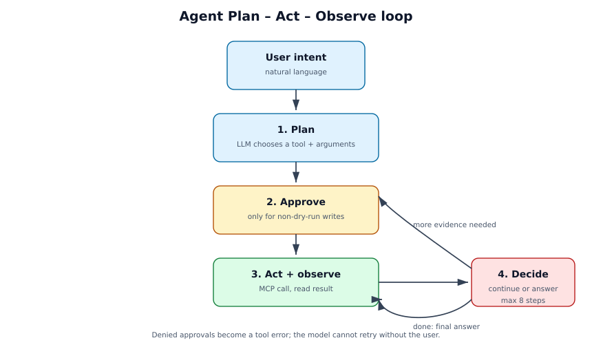
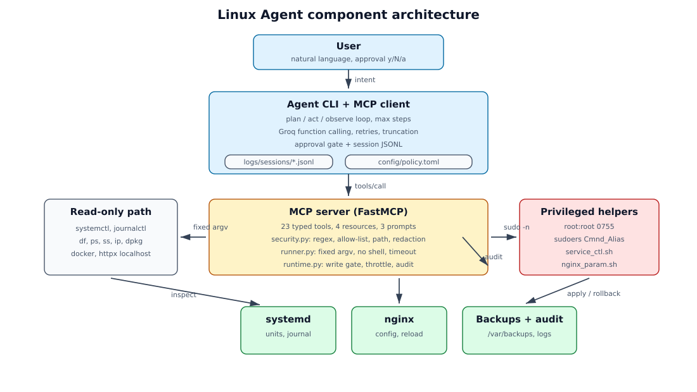
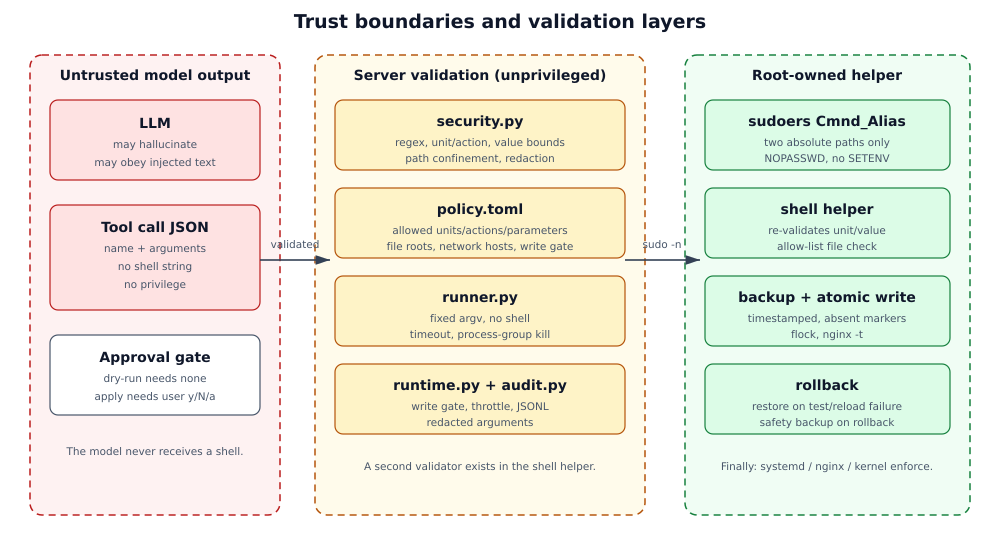

<!-- _class: lead -->
<!-- _paginate: false -->

# Linux Agent

## Agentic AI with MCP-Based Tool Use in Linux

**LINUX OSS 2026 — Final Project**

Group [X] · [Member 1] · [Member 2] · [Member 3]

Lecturer: [Lecturer name] · November 2026

---

## Agenda

1. Problem and objectives
2. Background: agents and MCP
3. Architecture and trust boundaries
4. Tools and the nginx helper
5. Agent, approval, audit
6. Demonstration
7. Testing, performance and security
8. Limitations and future work

> The claim: an LLM can perform useful Linux work **without a shell**, with a small,
> auditable blast radius.

---

## The problem

<div class="two">
<div>

### A chat model cannot operate a machine

- It can explain `systemctl` but cannot read the real state.
- It can hallucinate a unit, path, parameter or value.
- It cannot back up, validate or roll back.
- It leaves no evidence of what it did.

</div>
<div class="card bad">

### A shell tool is too much

- One injection = full user access.
- The model can chain arbitrary commands.
- Auditing free-form shell is hard.
- "Just be careful" is not a control.

</div>
</div>

**Goal:** a typed, allow-listed, dry-run-first tool boundary between the model and Linux.

---

## Objectives

<div class="three">
<div class="card">

### Research
Agentic AI architecture, function calling, MCP tools/resources/prompts.

</div>
<div class="card">

### Build
An MCP server, 23 tools, a Groq agent, safe service and nginx automation.

</div>
<div class="card">

### Prove
29 tests, a real-host demo, an isolated apply/rollback lab, audit evidence.

</div>
</div>

**Course requirement:** an extra shell script that changes service configuration
parameters — implemented as `scripts/nginx_param.sh`.

---

## Background: the agent loop

<div class="two">
<div>

### Plan → Act → Observe

1. The LLM chooses a tool and JSON arguments.
2. The client executes the tool.
3. The result is appended to the conversation.
4. The model continues or answers.

The model **never executes anything**. The boundary is the client/server.

</div>
<div>



</div>
</div>

<span class="small">Bounded to 8 steps. A denied approval becomes a tool error, not a retry.</span>

---

## Background: MCP

<div class="two">
<div>

### Model Context Protocol

- Open JSON-RPC 2.0 protocol.
- **Tools:** callable, typed, may have side effects.
- **Resources:** readable data by URI.
- **Prompts:** reusable task templates.
- Transports: **stdio** and **Streamable HTTP**.
- Annotations: `readOnlyHint`, `destructiveHint`.

</div>
<div class="card">

### Why it fits

| Ad-hoc shell | MCP |
|---|---|
| Not discoverable | `tools/list` |
| Unvalidated text | JSON Schema |
| One-off script | Reusable server |
| Hard to audit | Discrete calls |

</div>
</div>

---

## Architecture



<span class="small">Agent (Groq + MCP client) → MCP server (FastMCP) → read-only commands or
root-owned helpers → systemd/nginx. Policy, audit and backups sit beside the server.</span>

---

## Trust boundaries



<span class="small">The model is untrusted. The server validates; the helper validates again;
sudo and the kernel enforce the final boundary.</span>

---

## 23 tools, three risk classes

<div class="three">
<div class="card good">

### Read-only (20)

`system_overview`, `service_status`, `service_logs`, `failed_units`, `disk_usage`,
`process_top`, `network_overview`, `listening_ports`, `http_probe`, `package_info`,
`read_config`, `container_list`, `container_logs`, `nginx_info`, `nginx_*` reads.

</div>
<div class="card warn">

### Controlled writes (3)

`service_action` <span class="pill write">dry-run</span>

`nginx_set_parameter` <span class="pill write">dry-run</span>

`nginx_rollback` <span class="pill write">dry-run</span>

</div>
<div class="card">

### MCP extras

**Resources:** host summary, policy, nginx values, `logs/{unit}`.

**Prompts:** triage, safe nginx change, health report.

</div>
</div>

---

## Policy is data, not code

```toml
[security]
allow_write = false
audit_log = "logs/audit.jsonl"
min_write_interval_seconds = 1.0

[units]
allowed = ["nginx"]
actions = ["start", "stop", "restart", "reload"]

[nginx.parameters.client_max_body_size]
context = "http"
pattern = "^(0|[1-9][0-9]{0,4}[kKmMgG]?)$"
```

<div class="two">
<div class="card">

**Two layers must agree**

- `policy.toml` for the server.
- `/etc/linux-agent/allowed-units` for the root helper.

</div>
<div class="card">

**Environment overrides**

`LINUX_AGENT_ALLOW_WRITE=1`, `LINUX_AGENT_HELPER_DIR`, `GROQ_MODEL`, …

</div>
</div>

---

## The required shell script: `nginx_param.sh`

<div class="two">
<div>

### What it changes

- `worker_processes` (main)
- `worker_connections` (events)
- `client_max_body_size` (http)
- `keepalive_timeout`, `client_body_timeout`, `send_timeout`
- `gzip`, `server_tokens`

**8 parameters**, one allow-list.

</div>
<div>

### How it changes it

```text
list | get | set | test | status
list-backups | diff-backup | rollback
```

- HTTP parameters → managed drop-in.
- main/events → edit `nginx.conf`.
- value validated twice.
- atomic write, `flock`.
- `nginx -t`, optional reload.

</div>
</div>

---

## Change safety: backup, test, rollback

```text
set(param, value) →
  validate param + value
  render candidate (drop-in or nginx.conf)
  if dry-run: show diff, stop
  lock → timestamped backup → atomic write
  nginx -t
     fail → restore backup, remove new file, error
  reload (optional)
     fail → restore backup, restore old config, error
  success + backup id + diff
```

<div class="card warn">

**The absent-file marker** makes a failed first change correct: rollback removes the
new drop-in instead of leaving a half-applied config.

</div>

---

## Agent implementation

<div class="two">
<div>

### Groq + function calling

- MCP tools → OpenAI schemas.
- `tool_choice="auto"`.
- Retries for rate limit, connection, timeout.
- Blocking SDK call runs in a worker thread.
- Tool results truncated for the model; full result in the audit.

</div>
<div>

### CLI

```bash
.venv/bin/python agent.py
.venv/bin/python agent.py --list-tools
.venv/bin/python agent.py --prompt "..."
.venv/bin/python agent.py --transport streamable-http \
  --url http://127.0.0.1:8000/mcp
```

Interactive: `/tools`, `/reset`, `/audit`, `/policy`, `/quit`.

</div>
</div>

---

## Human approval

<div class="two">
<div>

### When it asks

- Read-only tool → **never**.
- Write tool + `dry_run=true` → **never**.
- Write tool + `dry_run=false` → **y / N / always**.
- Unknown mutating tool → **always ask**.

</div>
<div class="card">

```text
[!] Approval required
    tool: nginx_set_parameter
    args: {"parameter": "client_max_body_size",
           "value": "20m", "dry_run": false}
    Approve? [y]es / [N]o / [a]lways
```

<span class="small">`always` is per tool, per session. It is not persisted.</span>

</div>
</div>

---

## Audit and observability

<div class="two">
<div>

### Server audit

`logs/audit.jsonl`

- timestamp, tool, args, status, duration
- redacted secrets
- result preview
- one JSON object per line

</div>
<div>

### Session transcript

`logs/sessions/agent-*.jsonl`

- user message
- assistant message
- tool call
- approval decision
- tool result
- error

</div>
</div>

**Why two logs?** The server audit is the authoritative execution record; the session log
is the conversation context.

---

## Demo 1 — real host health check

```text
you> Give me a short health summary: host, uptime, disk usage,
     and whether nginx is running. Use the tools.
```

<div class="two">
<div class="card">

**Tool path**

`system_overview` → `disk_usage` → `service_status("nginx.service")`

</div>
<div class="card good">

**Observed**

Host `lcsang-G3-3590` · Ubuntu 26.04 · nginx active since 21:43:45 · `/` 89% used ·
14.9 GiB RAM · systemd running.

</div>
</div>

<span class="small">The answer quoted real tool output; no invented values.</span>

---

## Demo 2 — dry run, no change

```text
you> Plan a safe change of nginx client_max_body_size to 20m.
     Inspect current values, then show the dry-run diff.
```

```diff
--- /etc/nginx/conf.d/99-linux-agent.conf (current: absent)
+++ /etc/nginx/conf.d/99-linux-agent.conf (proposed)
+# Managed by linux-agent - manual edits will be overwritten.
+# Backups are stored in /var/backups/linux-agent/nginx.
+client_max_body_size 20m;
```

**No file created. No reload. Approval not requested for a dry run.**

---

## Demo 3 — lab apply + rollback

```bash
bash scripts/lab_demo.sh          # no root, isolated config
LAB_AGENT=1 bash scripts/lab_demo.sh   # also one Groq turn
```

| Step | Result |
|---|---|
| Dry run | diff, no write |
| Apply | `APPLIED 20m`, `nginx -t` passed, backup id |
| Verify | `Value: 20m` |
| Backups | `id: 2026...`, `old=(unset)`, `new=20m` |
| Rollback | `ROLLED BACK`, safety backup |
| Verify | `Value: unset` |

<span class="small">Full transcript: `docs/evidence/lab-demo.txt`.</span>

---

## Testing

<div class="two">
<div>

### 29 automated tests

| Area | Count |
|---|---:|
| Security, policy, params | 10 |
| Agent approval policy | 4 |
| nginx + service helpers | 13 |
| MCP stdio integration | 2 |

`Ran 29 tests in 4.394s — OK`

</div>
<div class="card good">

### What is covered

- injection and traversal rejection
- secret redaction
- parameter bounds
- dry-run isolation
- failed `nginx -t` restore
- rollback
- write gate
- MCP tools/resources/prompts
- lab write path + audit

</div>
</div>

---

## Performance

| Operation | Median |
|---|---:|
| `system_overview` | 14.8 ms |
| `disk_usage` | 12.8 ms |
| `service_status` | 20.7 ms |
| `nginx_list_parameters` | 62.7 ms |
| `read_config` | 8.7 ms |
| `http_probe` localhost | 18.6 ms |
| Full LLM turn | ~2.6 s |

<div class="card">

**The LLM dominates.** Linux tools are fast; the network/model round-trip and the 1 s
write throttle are the visible costs. NFR target: tool calls under 500 ms.

</div>

---

## Security analysis

<div class="three">
<div class="card good">

### Defended

- command injection
- option injection
- path traversal
- parameter injection
- secret leakage
- unapproved changes
- broken configs (rollback)
- untracked actions

</div>
<div class="card warn">

### Residual risk

- prompt injection in logs/config
- approval fatigue
- HTTP has no built-in auth
- redaction is heuristic
- audit is local
- syntax ≠ intent

</div>
<div class="card bad">

### Not claimed

- production multi-tenant safety
- protection from a compromised root
- protection from a malicious LLM provider
- correctness of the chosen value

</div>
</div>

---

## Limitations

<div class="two">
<div>

### Technical

- nginx is the only configurable service.
- `nginx -t` validates syntax, not business intent.
- No built-in HTTP authentication.
- Audit is local and append-only, not tamper-proof.
- Redaction patterns are heuristic.
- One file transaction at a time.

</div>
<div>

### Operational

- Human approval is required for every apply.
- Model behaviour varies between runs.
- No benchmark for task success yet.
- A root helper bug would run as root.
- The project is a teaching platform, not a control plane.

</div>
</div>

---

## Future work

1. **Auth:** OAuth 2.1 / mTLS for HTTP; per-user RBAC.
2. **Policy engine:** OPA/Rego, change windows, one-time approval tokens.
3. **More services:** PostgreSQL, Redis, SSH, cron, Compose — each with a validator.
4. **Sandboxing:** `systemd-run` with `DynamicUser`, `ProtectSystem`, `PrivateTmp`.
5. **Local models:** Ollama/vLLM for data-sensitive hosts.
6. **Benchmark:** 30–50 Linux tasks with safety outcomes.
7. **Web UI:** diff view, approval buttons, audit timeline.
8. **Remote audit:** hash chaining + remote syslog.

---

## Conclusion

<div class="two">
<div>

### What we built

- A real MCP server with **23 tools**, **4 resources**, **3 prompts**.
- A Groq agent with a bounded loop and human approval.
- A safe nginx helper: validate, backup, test, rollback.
- A root-owned install path with a validated sudoers rule.
- 29 tests, a lab demo and real-host evidence.

</div>
<div class="card good">

### The lesson

The hard part of agentic Linux is **not the LLM call**. It is the boundary:

- what may the model ask for?
- who validates it?
- how is it reversed?
- where is it recorded?

MCP gives a clean protocol for that boundary.

</div>
</div>

---

<!-- _class: lead -->

# Thank you

## Questions?

**Repository:** `/home/lcsang/linux-agent`

**Run it:**

```bash
.venv/bin/python agent.py --list-tools
.venv/bin/python agent.py
bash scripts/lab_demo.sh
```

---

<!-- _class: lead -->
<!-- _paginate: false -->

# Backup slides

Commands, file map and test output

---

## Backup: commands

```bash
# Read-only
.venv/bin/python agent.py --list-tools
.venv/bin/python agent.py

# One-time privileged install
sudo scripts/install_privileged.sh --user "$USER" --units "nginx"
sudo -n /usr/local/libexec/linux-agent/nginx_param.sh list

# Writes for one session
LINUX_AGENT_ALLOW_WRITE=1 .venv/bin/python agent.py

# HTTP transport
.venv/bin/python server.py --transport streamable-http --host 127.0.0.1 --port 8000
.venv/bin/python agent.py --transport streamable-http --url http://127.0.0.1:8000/mcp

# Verification
make check
make test
bash scripts/lab_demo.sh
```

---

## Backup: file map

```text
linux_agent/server.py          FastMCP registration, resources, prompts
linux_agent/tools/             diagnostics, services, nginx
linux_agent/agent/             Groq client, MCP loop, approval, CLI
linux_agent/security.py        validation, redaction, path confinement
linux_agent/runner.py          no-shell subprocess runner
linux_agent/runtime.py         write gate, throttle, audit decorator
config/policy.toml             allow-lists and limits
scripts/nginx_param.sh         safe nginx parameter changes
scripts/service_ctl.sh         allow-listed systemd actions
scripts/install_privileged.sh  root-owned install + visudo check
scripts/lab_demo.sh            isolated apply/rollback demo
tests/                         29 tests
docs/report.md                 final report
docs/slides.md                 this deck
```

---

## Backup: test output

```text
$ .venv/bin/python -m unittest discover -v
test_auto_approve ... ok
test_read_only_tool_never_needs_approval ... ok
test_unknown_mutating_tool_requires_approval ... ok
test_write_tool_dry_run_needs_no_approval ... ok
test_tools_resources_and_prompts ... ok
test_write_path_with_unprivileged_fake_helper ... ok
test_dry_run_does_not_write ... ok
test_failed_config_test_removes_new_file ... ok
test_failed_config_test_restores_existing_file ... ok
test_invalid_value_is_rejected ... ok
test_list_and_get ... ok
test_rollback ... ok
test_set_http_parameter_and_backup ... ok
test_set_main_and_events_parameters ... ok
test_unknown_parameter ... ok
test_allowed_action ... ok
test_disallowed_unit ... ok
test_invalid_action_and_unit ... ok
test_service_suffix_is_normalized ... ok
...
Ran 29 tests in 4.394s

OK
```
